# The mathematics of three generative models, step by step

*Normalizing flows, diffusion and flow matching, built up one small idea at a time.*

This tutorial explains the math behind the three model families compared in
[REPORT.md](REPORT.md). It goes in **small steps**. Each step adds one idea, gives the formula for
it, and shows it in a small example or picture. Most examples are 1D, where everything can be
computed exactly; the 2D pictures come after, from the trained models of the experiments. At the
end of each part a **checkpoint** sums up what was built.

**What you need:** derivatives and the chain rule, matrices and determinants, and Gaussians and
averages (expectations). Everything else is introduced on the way.

All figures are produced by `math_figs.py`.

**Contents**

- [Part 0. The goal, the examples, the notation](#part-0-the-goal-the-examples-the-notation)
- [Part 1. Normalizing flows](#part-1-normalizing-flows) (12 steps)
- [Part 2. Diffusion models](#part-2-diffusion-models) (9 steps)
- [Part 3. Flow matching](#part-3-flow-matching) (5 steps)
- [Part 4. All three side by side](#part-4-all-three-side-by-side)

---

## Part 0. The goal, the examples, the notation

All three models do the same job. They take **samples from a simple distribution**, a round
Gaussian $z \sim \mathcal N(0, I)$, and turn them into **samples from a complicated one**, the data
distribution $p$. A good model also tells us **how likely** a given point $x$ is: its density
$q(x)$. Training tries to make $q$ as close to $p$ as possible.

**The examples.**

| | what | why |
|---|---|---|
| **two bumps (1D)** | $p(x) = \tfrac12\mathcal N(x; -2, 0.3^2) + \tfrac12\mathcal N(x; 2, 0.3^2)$ | the simplest distribution with two separate modes; every formula below can be evaluated exactly |
| **sine band (2D)** | first coordinate $\theta$ spread evenly over $[-4, 4]$; second coordinate $y = 2\sin(\tfrac{\pi}{2}\theta) + 0.2\,\xi$ with $\xi \sim \mathcal N(0, 1)$ (2 periods) | the main example of REPORT.md. There $\theta$ is an "angle" and $y$ an "outcome": for a given outcome, several angles are possible, so $p(\theta \mid y)$ has several modes |
| **4×4 grid (2D)** | 16 equally likely Gaussians, centres at $\{-3, -1, 1, 3\}^2$, standard deviation 0.25 | only used in Part 4, to compare the three models' paths |

**Notation.** These symbols keep one meaning throughout (short-lived helper letters such as $a$, $\kappa$ or $c_t$ are defined where they appear):

| symbol | meaning |
|---|---|
| $z$ | noise, $z \sim \mathcal N(0, I)$, with density $p_Z$ |
| $x$ | a data point |
| $p$ | the true data distribution; $p_t$ is its noised version in Parts 2–3 |
| $q$ | the model's density |
| $f$ | the map of a flow, $x = f(z)$ |
| $J$ | a Jacobian matrix (Step 1.4) |
| $u$, $w$ | in Part 1: a direction (unit vector) and the coordinate along it, $w = u^\top z$ |
| $t$ | time, in Parts 2–3. It runs from 0 (data) to 1 (noise); generating a sample means running time **backwards**, from 1 to 0 |
| $v$ | a velocity, in Parts 2–3 |
| $\varepsilon$ | the noise added to a data point, in Parts 2–3 |

Subscripts: in Part 1, $z_l$ is the point after layer $l$. In Parts 2–3, $x_t$ is the point at
time $t$, so $x_0$ is data and $x_1$ is noise.

---

## Part 1. Normalizing flows

A normalizing flow is one fixed, invertible map $x = f(z)$. We need to know how a map changes a
density. We start with the simplest map there is.

### Step 1.1: A straight-line map in 1D

Take $x = 2z + 1$. Every sample is doubled and shifted. The histogram of $x$ is **twice as wide**,
and since the total probability must stay 1, it is also **half as high**:

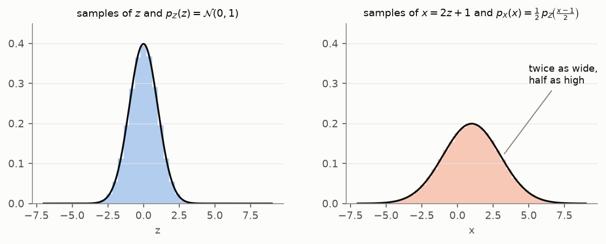

*Shaded: histograms of 200,000 samples. Black line: the formula below. They agree.*

As a formula, for $x = az + b$:

$$
p_X(x) = \frac{1}{|a|}\;p_Z\!\left(\frac{x - b}{a}\right).
$$

Read it as: go back to the $z$ that produced $x$, take its density, and divide by how much the map
stretches.

**Check:** at $x = 1$ (so $z = 0$): $p_X(1) = \tfrac12 \cdot 0.399 = 0.20$, the peak of the
right-hand curve.

### Step 1.2: A curved map in 1D

Now let the slope vary along the way. Zoom in on a tiny strip $[z, z + dz]$. It lands on
$[x, x + dx]$ with $dx = f'(z)\,dz$: locally the map *is* a straight line with slope $f'(z)$. The
same points are in both strips, so the probability is the same: $p_X(x)\,dx = p_Z(z)\,dz$. So

$$
p_X(x) = \frac{p_Z(z)}{|f'(z)|}, \qquad z = f^{-1}(x).
$$

**Where the map is steep, density goes down; where it is flat, density goes up.**

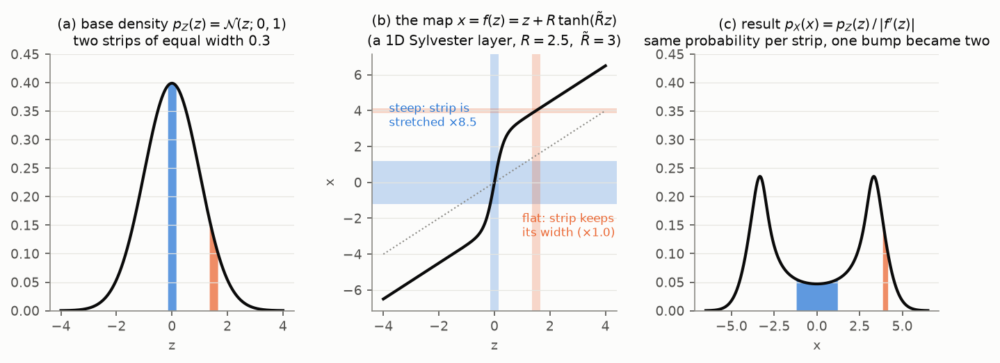

*(a) Two strips of the same width. (b) The map $f(z) = z + 2.5\tanh(3z)$. At $z = 0$ its slope is
$1 + 2.5\cdot 3 = 8.5$, so the blue strip is stretched 8.5×. At $z = 1.5$ the slope is about 1, so
the orange strip keeps its width. (c) The blue strip's probability is spread over 8.5× the width.*

**Check:** at $x = 0$: $p_X(0) = 0.399 / 8.5 = 0.047$, the bottom of the valley in (c).

This is already the key idea of the whole project: **to make a gap, stretch hard where the gap
should be.** The densest part of the Gaussian became a valley, and one bump became two.

### Step 1.3: In 2D, areas instead of lengths

In 2D a linear map $x = Az$ turns a small square into a parallelogram. Its area is multiplied by
$|\det A|$. The same probability is now spread over a different area, so the density is divided by
$|\det A|$:

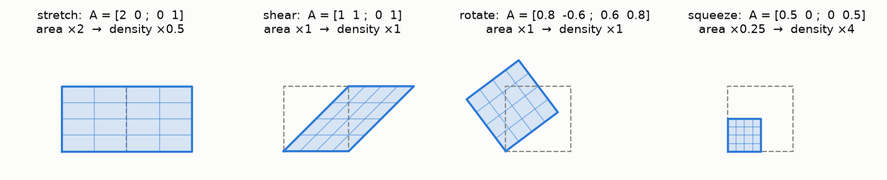

*Stretching the horizontal direction 2× doubles the area (density ×½). Shearing and rotating keep
it. Halving both directions quarters it (density ×4).*

$$
p_X(x) = \frac{p_Z(z)}{|\det A|}.
$$

### Step 1.4: Curved maps in 2D: the Jacobian

A curved 2D map looks linear when you zoom in far enough, just like in Step 1.2. The linear map
you see there is the **Jacobian matrix**, the matrix of all partial derivatives,
$J_f(z) = \begin{pmatrix}\partial f_1/\partial z_1 & \partial f_1/\partial z_2\\ \partial f_2/\partial z_1 & \partial f_2/\partial z_2\end{pmatrix}$.
It plays the role of $A$:

$$
p_X(x) = \frac{p_Z(z)}{|\det J_f(z)|}
\qquad\Longleftrightarrow\qquad
\log p_X(x) = \log p_Z(z) - \log|\det J_f(z)|.
$$

(A picture of this, with small circles turning into ellipses, follows in Step 1.8 once we have a
concrete map.)

### Step 1.5: Stacking maps

A flow is a stack of $L$ maps (layers). Start at $z_0 = z$, apply $z_l = f_l(z_{l-1})$ for
$l = 1, \dots, L$, and output $x = z_L$. By the chain rule the Jacobian of the stack is the product of
the layers' Jacobians, and the determinant of a product is the product of the determinants. So
areas multiply at every layer, and **log-areas add**:

$$
\log q(x) = \log p_Z(z_0) - \sum_{l=1}^{L}\log\left|\det J_{f_l}(z_{l-1})\right|.
$$

Each layer can be simple, but the stack can be complicated. In 1D, each simple layer below can
carve one valley, so three layers turn one bump into four:

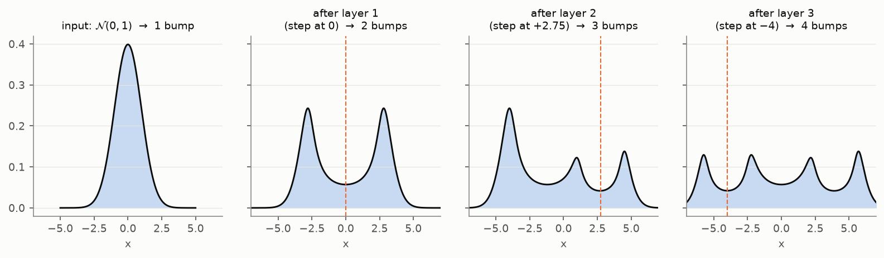

*Each layer is $x \mapsto x + R\tanh(\tilde R x + b)$ with its step at the dashed line. Layer 1
splits the Gaussian at 0. Layer 2 splits the right bump. Layer 3 splits the left bump.*

That gives two requirements for every layer: (1) it must be **invertible**, so we can find $z_0$
from $x$; and (2) $\log|\det J|$ must be **cheap**. A general $D\times D$ determinant costs
$O(D^3)$ operations.

### Step 1.6: The Sylvester layer in 1D

The layer from the last two figures is the 1D version of the Sylvester layer:

$$
w \;\mapsto\; w + R\,\tanh(\tilde R\,w + b).
$$

It adds a soft step (the $\tanh$) to the identity. $R$ is the **height** of the step and $\tilde R$
its **sharpness**. $b$ **shifts** it: the centre of the step, where $\tilde R w + b = 0$, is at
$w = -b/\tilde R$.

Its slope is $1 + R\tilde R\,\tanh'(\tilde R w + b)$. Since $\tanh'$ is 1 at the centre and falls
to 0 on both sides, the slope is 1 far away and **most different from 1 at the centre**, where it
equals $1 + R\tilde R$. So **the product $R\tilde R$ controls everything**:

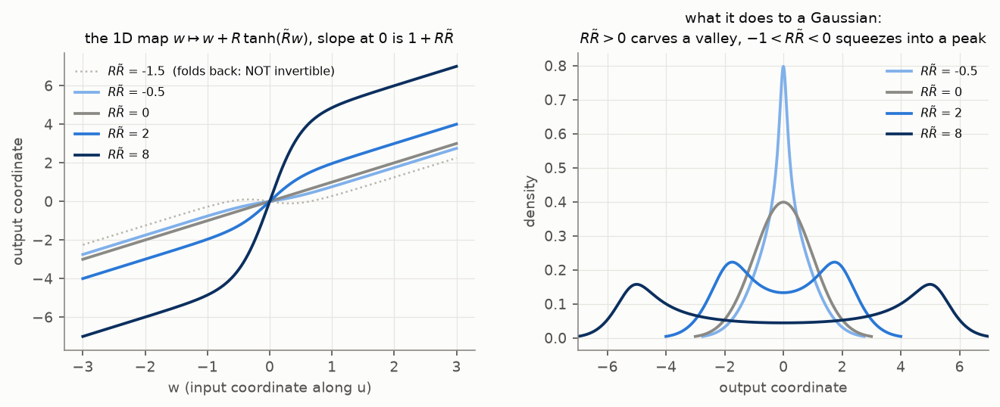

| $R\tilde R$ | slope at the centre | what happens to a Gaussian |
|---|---|---|
| $> 0$ | larger than 1: steep | stretched there: **valley**, two bumps (bigger product, deeper valley) |
| $0$ | 1: the identity | nothing |
| between $-1$ and $0$ | between 0 and 1: flat | squeezed there: a **sharper peak** |
| $< -1$ | negative: the map **folds back** | not invertible, so not allowed |

So the rule for invertibility is simply $R\tilde R > -1$. The parametrisations in REPORT.md
(Section 2) guarantee it.

### Step 1.7: The Sylvester layer in 2D, in three sub-steps

In $D$ dimensions, the layer picks a direction $u$ (a unit vector) and does the 1D step *along
that direction*:

1. **Project:** $w = u^\top z$, the coordinate of $z$ along $u$.
2. **Step in 1D:** compute how far to move, $R\tanh(\tilde R w + b)$.
3. **Move along $u$:** $z' = z + u\,R\tanh(\tilde R\,u^\top z + b)$.

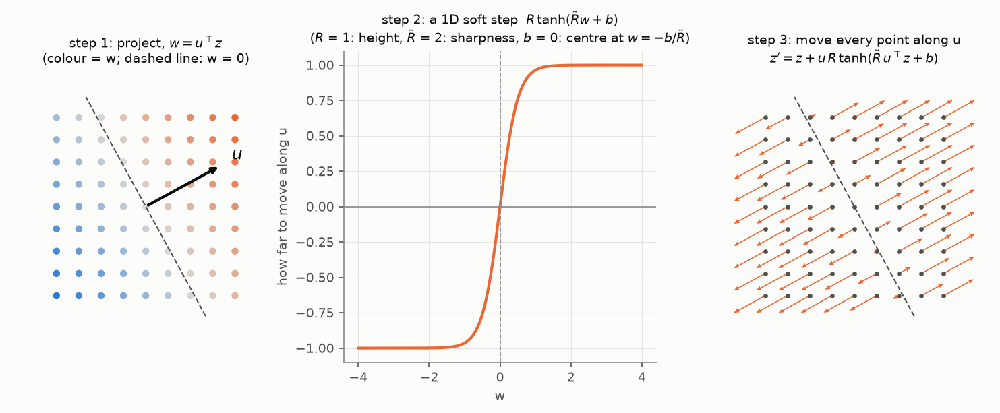

*Points on the dashed line ($w = 0$) are at the centre of the step. Points on one side move
forward along $u$, points on the other side move backward. Points near the line move the least,
but the movement changes fastest there, so that is where space is stretched.*

The full layer does this for $M \le D$ directions at once. The directions are orthonormal (unit
length, at right angles to each other) and are the columns of a $D\times M$ matrix
$Q = [u_1 \dots u_M]$. Then $w = Q^\top z$ is a vector of $M$ coordinates, $b \in \mathbb R^M$,
and $R, \tilde R$ become $M\times M$ **upper-triangular** matrices (zeros below the diagonal):

$$
z' = z + Q\,R\,\tanh\!\big(\tilde R\,Q^\top z + b\big).
$$

The off-diagonal entries of $R, \tilde R$ let the directions influence each other. Why
orthonormal and why triangular? Because that makes the determinant cheap (Step 1.8) and the inverse
easy (Step 1.11). Only the coordinates along the $u_i$ change; **everything orthogonal to them is
left alone**.

### Step 1.8: The layer's Jacobian, with a picture

Take $M = 1$ first. Differentiating $z' = z + u\,R\tanh(\tilde R\,u^\top z + b)$ with the chain
rule:

$$
J = I + \kappa\;u\,u^\top,
\qquad \kappa = R\tilde R\,h', \qquad h' = \tanh'(\tilde R\,u^\top z + b).
$$

What does $J$ do to a vector? The matrix $u u^\top$ maps $y$ to $u\,(u^\top y)$: it keeps only the
part of $y$ along $u$. So:

- along $u$: $J u = u + \kappa\,u = (1 + \kappa)\,u$, a stretch by $1 + \kappa$;
- across $u$ (any $y$ with $u^\top y = 0$): $J y = y$, no change.

These are the eigenvalues of $J$: $1 + \kappa$ once and 1 for every other direction. The determinant is
the product of the eigenvalues:

$$
\det J = 1 + R\tilde R\,h'.
$$

**Example.** With $R\tilde R = 3$, a point on the centre line has $h' = 1$, so a small circle there
becomes an ellipse 4× longer along $u$ (area ×4). Far from the line $h' \approx 0$, and the circle
stays a circle:

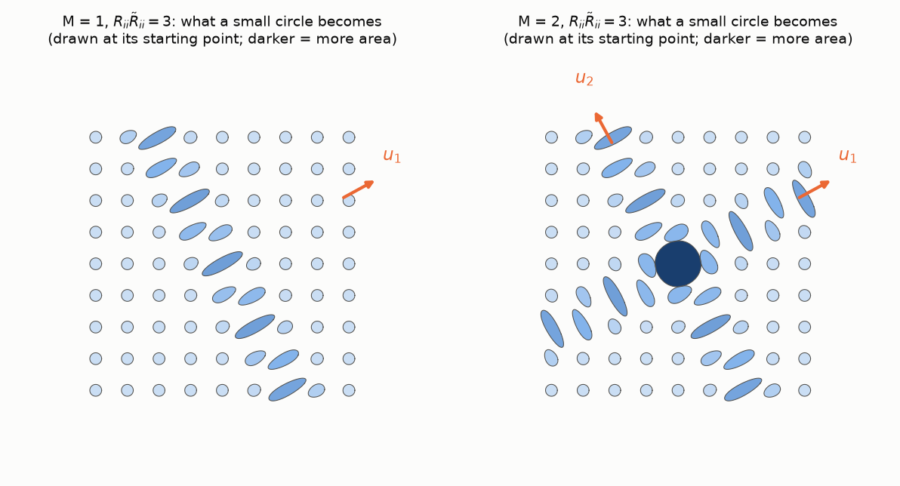

*Each ellipse is $J$ applied to a small circle, drawn at the circle's starting point. Left: one
direction. The ellipses lie along the centre line ($w = 0$, at right angles to $u_1$) and are
stretched along $u_1$. Right: two directions give two such lines. Where they cross, both stretches
act at once, and the circle grows in every direction (the big dark disc).*

**General $M$: Sylvester's determinant identity.** Now
$J = I_D + Q\,R\,H\,\tilde R\,Q^\top$ with $H = \operatorname{diag}(h'_1, \dots, h'_M)$. In four small
steps:

1. Sylvester's identity, a standard fact of linear algebra: $\det(I_D + AB) = \det(I_M + BA)$ for
   $A$ of size $D\times M$ and $B$ of size $M\times D$. (It turns a $D\times D$ determinant into an
   $M\times M$ one.) Take $A = QR$ and $B = H\tilde R Q^\top$:
   $\det J = \det(I_M + H\tilde R\,Q^\top Q\,R)$.
2. The columns of $Q$ are orthonormal, so $Q^\top Q = I_M$: $\det J = \det(I_M + H\tilde R R)$.
3. $H$ is diagonal and $\tilde R, R$ are upper triangular. Products of upper-triangular matrices
   are upper triangular, so $I_M + H\tilde R R$ is upper triangular with diagonal entries
   $1 + h'_i\tilde R_{ii}R_{ii}$.
4. The determinant of a triangular matrix is the product of its diagonal:

$$
\log|\det J| = \sum_{i=1}^{M}\log\big(1 + h'_i\,R_{ii}\tilde R_{ii}\big).
$$

That is $M$ numbers instead of an $O(D^3)$ determinant. For $M = 1$ it is the formula from the
example above.

**Keeping $Q$ orthonormal.** $Q$ is stored as a free matrix $W$ and orthonormalised on every forward
pass with the Björck iteration $Q \leftarrow Q\big(\tfrac32 I - \tfrac12 Q^\top Q\big)$, started
from $W/\lVert W\rVert_F$. That starting point guarantees convergence, and the result is the
orthonormal matrix closest to $W$. PyTorch differentiates through the iterations, so $W$ can be
trained like any other parameter.

### Step 1.9: What one layer does to a Gaussian

Putting Steps 1.4 and 1.8 together: where the layer stretches (large $\log|\det J|$), the density
drops. Along the centre line, the Gaussian is torn open:

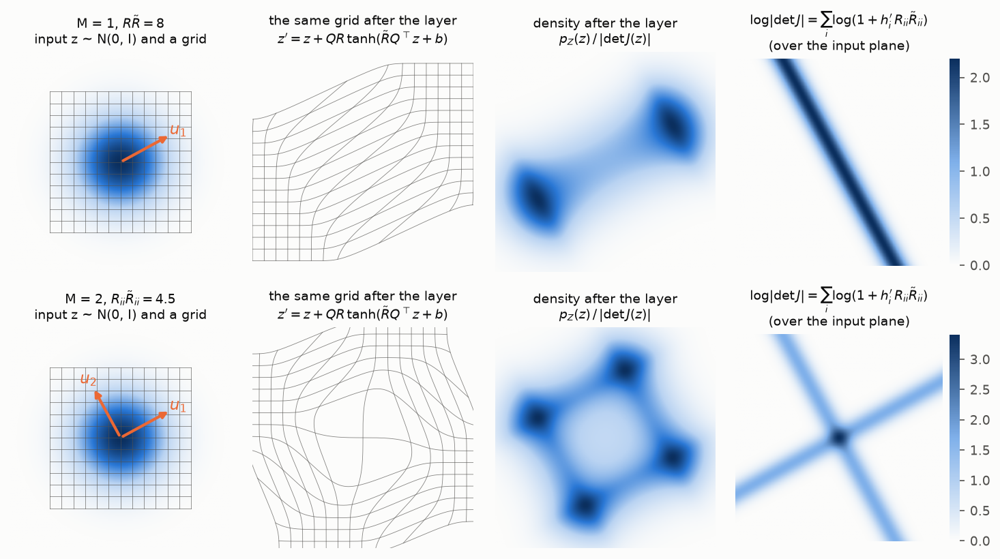

*Row by row: input with grid → grid after the layer → density after the layer →
$\log|\det J|$. One direction ($M = 1$, $R\tilde R = 8$) gives two bumps; two directions ($M = 2$,
$R_{ii}\tilde R_{ii} = 4.5$) give four.*

### Step 1.10: Many layers: stretch, then bend

One layer only makes a few tears. The flows in REPORT.md stack 64. Following a trained flow (2-period
sine band) layer by layer:

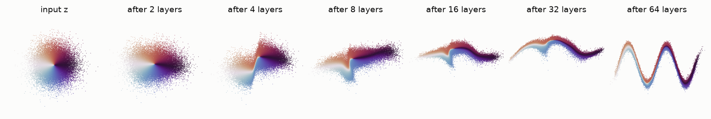

*Colour = the angle of the starting point around the origin, so each part of the Gaussian can be
followed. The early layers squash the round blob into a long, thin ribbon: its left side (white)
goes to the left end, its right side (dark) to the right end, its upper half (red) to the upper
edge and its lower half (blue) to the lower edge. The later layers **bend** the ribbon into the
sine shape.*

More periods need more bends, and each bend costs several layers. That's why depth sets the limit
in REPORT.md.

### Step 1.11: Going backwards (the inverse)

To evaluate $q(x)$ we must run the flow backwards, $z = f^{-1}(x)$, one layer at a time from the
top.

**One direction ($M = 1$).** We know $z'$ and want $z$. Project both sides of
$z' = z + u\,R\tanh(\tilde R\,u^\top z + b)$ onto $u$. Since $u^\top u = 1$, the unknown $w = u^\top z$
must solve the 1D equation

$$
g(w) := w + R\tanh(\tilde R w + b) = w', \qquad w' = u^\top z' \text{ (known)}.
$$

$g$ is strictly increasing (Step 1.6: slope $> 0$ when $R\tilde R > -1$), so there is **exactly one
solution**. Once $w$ is known, $z = z' - u\,R\tanh(\tilde R w + b)$.

**Solving it: Newton's method.** Repeat $w_{k+1} = w_k - \dfrac{g(w_k) - w'}{g'(w_k)}$: replace the
curve by its tangent line and jump to where the tangent reaches $w'$. A worked example with
$R = 2$, $\tilde R = 2$, $b = 0.4$, $w' = 2.5$, starting from $w_0 = w'$:

| $k$ | $w_k$ | $g(w_k) - w'$ |
|---|---|---|
| 0 | 2.5000 | +2.0 |
| 1 | 0.5007 | −0.23 |
| 2 | 0.6231 | −0.020 |
| 3 | 0.6361 | −1.7·10⁻⁴ |
| 4 | 0.6362 | −1.2·10⁻⁸ |
| 5 | 0.6362 | 0 |

Once close, the number of correct digits roughly doubles every step.

**Two directions ($M = 2$): back-substitution.** Write $w_i = u_i^\top z$ and
$w'_i = u_i^\top z'$. Written out, the layer is

$$
\begin{aligned}
w'_1 &= w_1 + R_{11}\tanh(\tilde R_{11}w_1 + \tilde R_{12}w_2 + b_1) + R_{12}\tanh(\tilde R_{22}w_2 + b_2),\\
w'_2 &= w_2 + R_{22}\tanh(\tilde R_{22}w_2 + b_2).
\end{aligned}
$$

Because $R, \tilde R$ are upper triangular, the **second line only involves $w_2$**: solve it as a
1D problem. With $w_2$ known, the first line is a 1D problem in $w_1$. In general: solve for $w_M$,
then $w_{M-1}$, …, then $w_1$, each a 1D Newton solve.

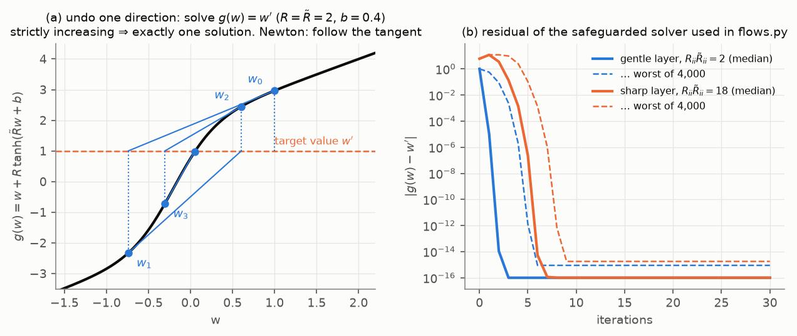

*(a) A harder target, $w' = 1$, again starting at $w_0 = w'$. Newton overshoots back and forth
across the steep part before settling. To make this safe, the solver keeps an interval that must
contain the solution and bisects whenever a Newton step leaves it or makes too little progress.
(b) The error for 4,000 targets. A gentle layer ($R\tilde R = 2$, like the trained ones) reaches
rounding error in at most 6 iterations; a very sharp one ($R\tilde R = 18$) in at most 9. The code
uses 30.*

> While making panel (b) I found and fixed two weaknesses in the original solver. A converged step
> that landed exactly on the interval edge was thrown back to the midpoint, and Newton could cycle
> on very sharp layers. The trained models in REPORT.md have $|R_{ii}\tilde R_{ii}| \le 2.3$ and
> invert to within $5\cdot10^{-6}$ with both versions, so no result changes.

### Step 1.12: Training by maximum likelihood

Now everything is in place. For a data point $x$: run the flow backwards to get $z_0$, add up the
log-determinants on the way, and get $\log q(x)$ (Step 1.5). Training makes the data as likely as
possible:

$$
\text{loss} = -\frac1n\sum_{i=1}^{n}\log q_\theta(x_i).
$$

**Why this loss, and what is its best value?** For many samples the loss is the average
$\mathbb E_{x\sim p}[-\log q(x)]$, the **cross-entropy**. It splits into two parts:

$$
\mathbb E_p[-\log q] = \underbrace{\mathbb E_p[-\log p]}_{\text{entropy } H(p)} \;+\; \underbrace{\mathbb E_p\!\left[\log \frac{p}{q}\right]}_{\text{KL divergence } \mathrm{KL}(p\,\|\,q)} .
$$

The entropy depends only on the data. The KL divergence is never negative and is 0 only when
$q = p$. So minimising the loss pushes $q$ towards $p$, and the best possible loss is the entropy
of the data. For the two bumps that is 0.91.

Here is a tiny 1D flow (6 layers, 18 parameters) trained on the two-bump data:

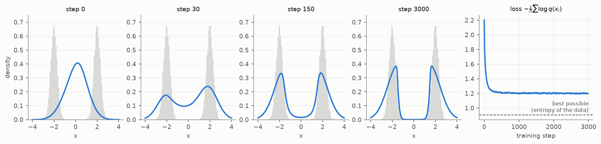

*Within 30 steps the single bump starts to split; by step 150 there are two bumps in the right
places. The loss drops fast and then levels off at about 1.2, above the floor of 0.91.*

Why can't it reach the floor? Look at the shape at step 3000: each bump is lopsided, too steep on
the inside and too wide on the outside. The outside is the real limit. Far from all its steps,
every layer has slope $\approx 1$ (because $\tanh' \to 0$), so **the tails of a Sylvester flow stay
as wide as the starting Gaussian**. It can carve valleys but cannot make the outside thinner. The
data bumps have width 0.3, so the tails can't fit.

(REPORT.md also uses the opposite direction, *reverse KL*, $\mathrm{KL}(q\,\|\,p)$. It trains from
the target's formula instead of samples, and tends to drop bumps. See REPORT.md, Section 3.)

### Checkpoint, Part 1

| idea | formula |
|---|---|
| change of variables | $\log q(x) = \log p_Z(z) - \log\lvert\det J\rvert$ |
| stack of layers | log-determinants add up |
| one Sylvester layer | $z' = z + QR\tanh(\tilde RQ^\top z + b)$: soft steps along $M$ orthonormal directions |
| its determinant | $\sum_i\log(1 + h'_i R_{ii}\tilde R_{ii})$, cheap thanks to Sylvester's identity and triangular $R, \tilde R$ |
| invertible when | $R_{ii}\tilde R_{ii} > -1$; inverse by back-substitution + 1D Newton |
| training | minimise $-\log q$, which minimises $\mathrm{KL}(p\,\|\,q)$ |
| bumps come from | stretching (valleys), and many layers to bend the result into shape |

---

## Part 2. Diffusion models

A flow has to *design* the noise → data map. Diffusion turns the problem around. It defines the
easy direction, **data → noise**, and then learns to **undo** it.

### Step 2.1: Noising one point

Take a data point $x_0$. Noise it to level $t$:

$$
x_t = \alpha_t\,x_0 + \sigma_t\,\varepsilon, \qquad \varepsilon \sim \mathcal N(0, I)\ \text{(in 1D: } \mathcal N(0, 1)\text{)}.
$$

$\alpha_t$ shrinks the signal and $\sigma_t$ grows the noise. The schedule used here ("variance
preserving", VP) gives these values:

| $t$ | 0.1 | 0.25 | 0.4 | 0.5 | 0.75 | 1 |
|---|---|---|---|---|---|---|
| $\alpha_t$ (signal) | 0.95 | 0.72 | 0.44 | 0.28 | 0.06 | 0.007 |
| $\sigma_t$ (noise) | 0.32 | 0.69 | 0.90 | 0.96 | 1.00 | 1.00 |

At $t = 1$ almost nothing of $x_0$ is left: $x_1$ is $\mathcal N(0, 1)$ noise, whatever $x_0$ was.
That is why generating can start from plain noise. (The code starts time at
$t_{\min} = 0.001$ instead of 0, where $\sigma = 0.01$; that avoids dividing by $\sigma = 0$ later.)

**Where do these numbers come from?** From noising in many tiny steps. In each step of length
$\Delta t$, shrink a little and add a little fresh noise:

$$
x \;\leftarrow\; \sqrt{1 - \beta\,\Delta t}\;x + \sqrt{\beta\,\Delta t}\;\xi, \qquad \xi \sim \mathcal N(0, 1) \text{ new each step}.
$$

The rate $\beta(t)$ rises linearly from 0.1 to 20, so the noising is slow at first and fast at the end.

- **The signal** is multiplied by $\sqrt{1 - \beta\Delta t} \approx 1 - \tfrac12\beta\Delta t$ every
  step. Over many steps that multiplies up to $\alpha_t = \exp\!\big(-\tfrac12\int_0^t\beta(s)\,ds\big)$.
- **The noise variance** $V$ becomes $(1 - \beta\Delta t)V + \beta\Delta t$ every step, so $1 - V$ is
  multiplied by $1 - \beta\Delta t$. Starting from $V = 0$, that gives $1 - V = \alpha_t^2$, so
  $\sigma_t^2 = 1 - \alpha_t^2$. That is the "variance preserving" property,
  $\alpha_t^2 + \sigma_t^2 = 1$.

In the limit of tiny steps this is a **stochastic differential equation (SDE)**, usually written
$dx = -\tfrac12\beta(t)\,x\,dt + \sqrt{\beta(t)}\,dW$. Here $dW$ is shorthand for the
$\sqrt{\Delta t}\,\xi$ term (its running sum $W$ is called Brownian motion).

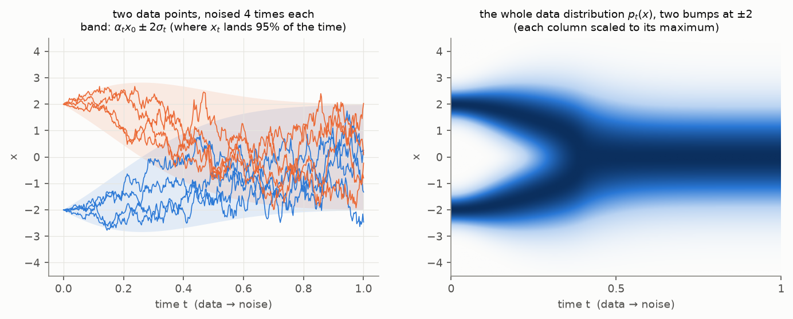

*Left: two data points (at ±2), each noised four times with the tiny-step recipe; that's why the
paths are jagged. The coloured band is where $x_t$ ends up 95% of the time: centre $\alpha_t x_0$,
half-width $2\sigma_t$. The one-line formula $x_t = \alpha_t x_0 + \sigma_t\varepsilon$ gives the same
spread at each time, without simulating the steps. Right: the same for the whole two-bump
distribution (next step).*

### Step 2.2: Noising the whole distribution

Each data point becomes a little Gaussian, so the noisy distribution $p_t$ is the data
distribution **blurred**. For the two-bump example it can be written down exactly. Each bump
$\mathcal N(\pm2, 0.3^2)$ is scaled by $\alpha_t$ and gets variance $\sigma_t^2$ added:

$$
p_t(x) = \tfrac12\,\mathcal N\!\big(x;\, -2\alpha_t,\; 0.3^2\alpha_t^2 + \sigma_t^2\big)
       + \tfrac12\,\mathcal N\!\big(x;\, +2\alpha_t,\; 0.3^2\alpha_t^2 + \sigma_t^2\big).
$$

In the right panel above, the two bumps blur together into one at $t \approx 0.4$.

The same thing for the 2D sine band, shown together with the straight-line path that flow matching
uses (Part 3):

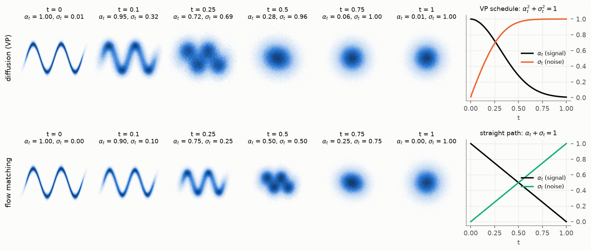

Read right to left, each row is the generation process: **one blob that splits into bumps
gradually**. The model only ever has to make small changes, from coarse to fine.

### Step 2.3: The score: an arrow towards higher density

To walk back from noise to data we need to know, at every noise level, *which way is the data*.
That's the **score**, the gradient of the log-density:

$$
\nabla_x\log p_t(x).
$$

It points uphill, towards higher density. **Small example:** for a single Gaussian
$\mathcal N(m, s^2)$, $\log p = -\tfrac{(x - m)^2}{2s^2} + \text{const}$, so the score is
$-(x - m)/s^2$: a straight line through zero at the peak, pointing back towards $m$ from both
sides. For the two bumps:

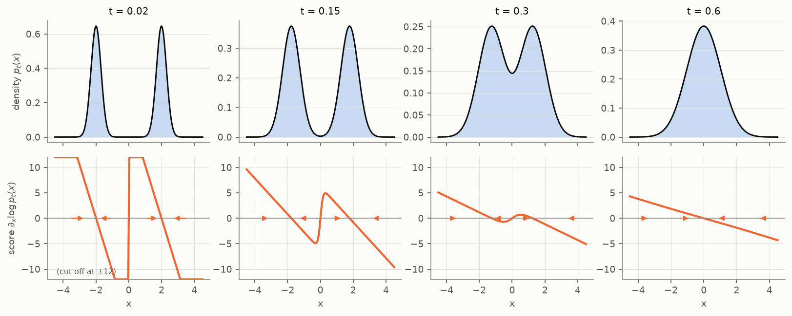

*Top: $p_t$. Bottom: its score (arrows show its direction at a few points; values beyond ±12 are
cut off). At $t = 0.02$, each bump pulls points towards itself, and the score jumps at the valley in
the middle: that is the "decision" which bump to go to. At $t = 0.6$ there is only one blob, and the
score is a single straight line, like a single Gaussian's.*

### Step 2.4: Learning the score by guessing the noise

We don't know $p_t$ for real data, so we can't compute the score. The trick is to **train a
network $\hat\varepsilon_\theta(x_t, t)$ to guess which noise was added**. Each training example is
made by picking a data point $x_0$, a time $t$ uniformly in $[t_{\min}, 1]$ and a noise
$\varepsilon$, and the loss is

$$
\mathcal L_{\text{DM}}(\theta) = \mathbb E_{t,\,x_0,\,\varepsilon}\;
\big\lVert\hat\varepsilon_\theta(\alpha_t x_0 + \sigma_t\varepsilon,\; t) - \varepsilon\big\rVert^2 .
$$

Why does that give the score? In three small steps:

**(a) Least squares learns the average.** For a fixed input, the best constant guess $a$ for a
random target $Y$ minimises $\mathbb E[(a - Y)^2]$. Setting the derivative $2(a - \mathbb E[Y])$ to
zero gives $a = \mathbb E[Y]$. So the trained network outputs
$\hat\varepsilon(x, t) = \mathbb E[\varepsilon \mid x_t = x]$, the average noise among all the ways
to reach $x$.

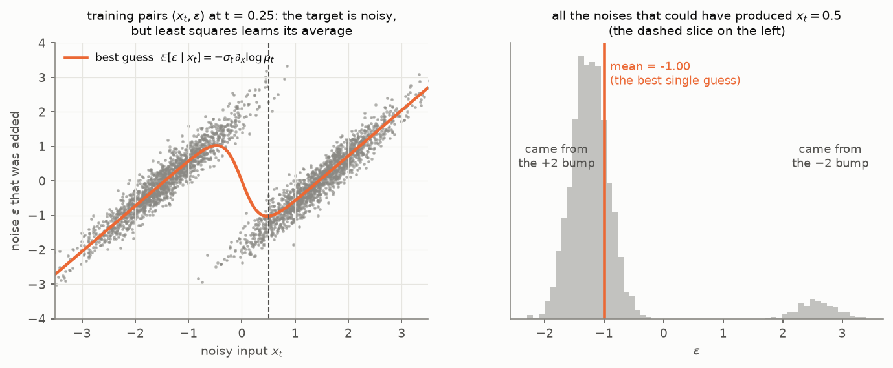

*Left: training pairs $(x_t, \varepsilon)$ at $t = 0.25$. For the same input the target varies, but
the regression learns the orange average. Right: every $\varepsilon$ that could have produced
$x_t = 0.5$. Most came from the +2 bump ($\varepsilon \approx -1.3$), a few from the −2 bump
($\varepsilon \approx +2.6$). The average, −1.0, is the network's answer.*

**(b) For one data point, the noise *is* the score.** Given $x_0$, $x_t$ is Gaussian,
$\mathcal N(\alpha_t x_0, \sigma_t^2)$. By the small example of Step 2.3, its score is
$-(x_t - \alpha_t x_0)/\sigma_t^2 = -\varepsilon/\sigma_t$.

**(c) Averaging over $x_0$ gives the score of $p_t$.** $p_t$ is a mixture: the average of the
little Gaussians $p(x \mid x_0)$ over all data points. Differentiate its log:

$$
\nabla\log p_t(x) = \frac{\nabla p_t(x)}{p_t(x)}
= \int \nabla\log p(x\mid x_0)\;\underbrace{\frac{p(x\mid x_0)\,p(x_0)}{p_t(x)}}_{=\;p(x_0\mid x)\ \text{(Bayes' rule)}}\,dx_0
= \mathbb E\big[\nabla\log p(x\mid x_0)\;\big|\;x_t = x\big].
$$

(The middle step uses $\nabla p = p\,\nabla\log p$.) In words: the score of the mixture is the
average of the little Gaussians' scores, each weighted by how likely it is to have produced $x$.
Inserting (b), and then (a):

$$
\nabla_x\log p_t(x) = -\frac{\mathbb E[\varepsilon\mid x_t = x]}{\sigma_t}
\quad\Longrightarrow\quad
\boxed{\;\nabla_x\log p_t(x) \approx -\frac{\hat\varepsilon_\theta(x, t)}{\sigma_t}\;}
$$

The orange curve in the left panel is exactly $-\sigma_t\,\nabla_x\log p_t$.

### Step 2.5: The learned score in 2D

The same thing on the sine band, from the trained 35k-parameter diffusion model:

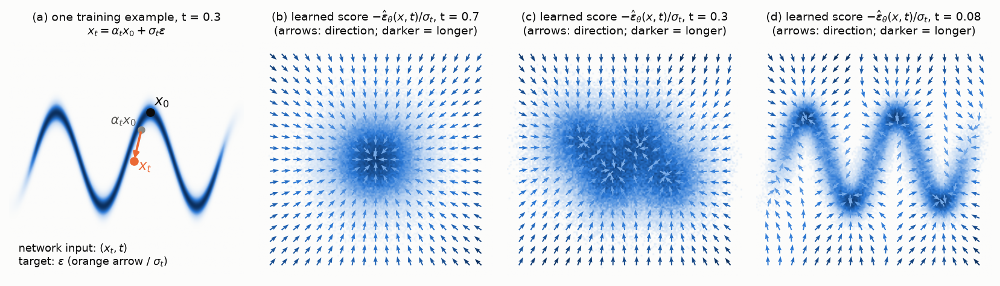

*(a) One training example: $x_0$ on the band, shrunk to $\alpha_t x_0$, plus noise (orange arrow).
(b–d) The learned score at three noise levels. At $t = 0.7$ it points to the centre of one blob; at
$t = 0.3$ it starts to separate the arches; at $t = 0.08$ it points to the nearest part of the band.
Arrows show direction only; darker means stronger.*

### Step 2.6: A tool: how a density moves when its points move

Before we can generate, we need one tool. Suppose every point moves with a velocity $v(x, t)$. How
does the density $p_t$ change?

**Small example.** If every point moves with the same speed $a$, the density just slides along:
$p_t(x) = p_0(x - at)$. Differentiating gives $\partial_t p = -a\,\partial_x p$, which matches the
general formula below with $v = a$.

**In general (1D).** The probability flowing past position $x$ per unit time, the **flux**, is
(density) × (velocity) $= p\,v$. Probability is never created or destroyed, so the amount in a small
interval changes by what flows in minus what flows out:

```
        flux in                      flux out
   p(x) v(x)  ──▶  [ x ,  x + dx ]  ──▶  p(x+dx) v(x+dx)

   change of (p dx) per unit time  =  p v (x)  −  p v (x+dx)
```

Divide by $dx$ and let it shrink:

$$
\partial_t p_t = -\partial_x\big(p_t\,v\big) \qquad\text{(the continuity equation; in 2D: } -\nabla\!\cdot(p_t v)\text{)}.
$$

It also works the other way round: **if a family of densities $p_t$ satisfies this equation with
some $v$, then moving points with velocity $v$ carries $p_t$ along.** The reason: the moving
points also have densities that satisfy the equation, and they start from the same density; for a
well-behaved $v$ the equation has only one solution from a given start, so the two families
agree at every time. Steps 2.7 and 3.3 both use this.

### Step 2.7: From the score to samples

**Option 1: the reverse SDE.** A classical result (Anderson, 1982): the noising process run
backwards in time is again a tiny-step random process, with an extra drift along the score. Going
from $t$ to $t - \Delta t$:

$$
x \;\leftarrow\; x + \big[\tfrac12\beta\,x + \beta\,\nabla\log p_t(x)\big]\,\Delta t + \sqrt{\beta\,\Delta t}\;\xi .
$$

The score term pulls points towards higher density, and fresh noise $\xi$ is added at each step.

**Option 2: the probability-flow ODE.** The same distributions $p_t$ can be produced *without*
noise. In four small steps (1D for readability):

1. The density of the tiny-step process $dx = f\,dt + g\,dW$ (here $f = -\tfrac12\beta x$,
   $g = \sqrt\beta$) changes by the Fokker–Planck equation, a standard result we quote without proof:
   $\partial_t p = -\partial_x(f\,p) + \tfrac12 g^2\,\partial_x^2 p$. The first term is the
   continuity equation for the drift $f$. The second is the spreading caused by the noise; it is the
   heat equation, which is how a blur grows.
2. Rewrite the second derivative: $\partial_x^2 p = \partial_x(p\,\partial_x\log p)$, since
   $p\,\partial_x\log p = \partial_x p$.
3. Combine: $\partial_t p = -\partial_x\big(\big[f - \tfrac12 g^2\,\partial_x\log p\big]\,p\big)$.
4. That is the continuity equation of Step 2.6 with velocity $v = f - \tfrac12 g^2\,\partial_x\log p$.
   So points that simply *move* with this $v$, without any randomness, have the same densities $p_t$.

With $f = -\tfrac12\beta x$ and $g^2 = \beta$, and the score from Step 2.4:

$$
\frac{dx}{dt} = -\tfrac12\beta(t)\big(x + \nabla\log p_t(x)\big)
\approx -\tfrac12\beta(t)\,x + \tfrac12\beta(t)\,\frac{\hat\varepsilon_\theta(x, t)}{\sigma_t}.
$$

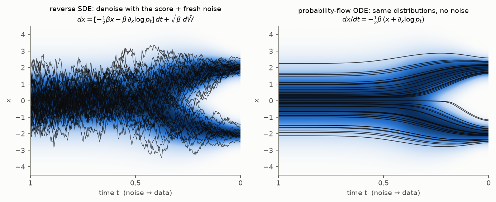

*Both start from the same 40 noise samples (left edge) and use the exact score of the two-bump
$p_t$ from Step 2.2. Left: the SDE paths jitter but end in the two bumps. Right: the ODE paths are
smooth and deterministic, and end in the same two bumps with the same proportions.*

The code in this project uses the ODE, because it is deterministic and gives an exact density
(Step 2.9).

### Step 2.8: Solving the ODE in steps

An ODE $dx/dt = v(x, t)$ is solved numerically in small time steps. Going backwards from $t$ to
$t - \Delta t$:

- **Euler's method:** $x \leftarrow x - \Delta t\; v(x, t)$. Follow the current velocity in a straight
  line. One velocity evaluation per step.
- **RK4 (Runge–Kutta, 4th order):** evaluate $v$ four times per step (at the start, twice halfway,
  at the end) and take a weighted average. Much more accurate for the same step size.

Every evaluation of $v$ is one pass through the network. So the **number of network evaluations**
is the cost of a sample. **Straight paths are cheap:** if a path is a straight line at constant
speed, a single Euler step follows it exactly. Curved paths need many small steps. That's the
sampling cost in REPORT.md, Section 7.4.3.

### Step 2.9: The density along a path

A flow's density came from tracking how much each layer stretches space (Step 1.5). An ODE does
the same thing in tiny steps.

**One tiny step stretches space by the divergence.** One Euler step $x \mapsto x + \Delta t\,v(x)$
has Jacobian $I + \Delta t\,\nabla v$, where $\nabla v$ is the matrix of partial derivatives
$\partial v_i/\partial x_j$. For a small $\Delta t$,

$$
\log\det(I + \Delta t\,\nabla v) \approx \Delta t\cdot\operatorname{trace}(\nabla v)
= \Delta t\,\Big(\frac{\partial v_1}{\partial x_1} + \frac{\partial v_2}{\partial x_2} + \dots\Big)
= \Delta t\;\nabla\!\cdot v .
$$

(For 2×2, writing $\partial_j v_i$ for $\partial v_i/\partial x_j$:
$\det(I + \Delta t\,\nabla v) = 1 + \Delta t\,(\partial_1 v_1 + \partial_2 v_2) + \Delta t^2\det(\nabla v)$,
and $\log(1 + y) \approx y$ for small $y$.)
The sum $\nabla\!\cdot v$ is the **divergence**: the rate at which the flow stretches space. Adding
up the log-determinants of all the tiny steps, as in Step 1.5, turns into an integral.

**The same result from the continuity equation (1D).**

1. Expand Step 2.6: $\partial_t p = -\partial_x(p\,v) = -v\,\partial_x p - p\,\partial_x v$.
2. Follow one moving point $x(t)$ with the chain rule: $\dfrac{d}{dt}\log p_t(x(t)) = \partial_t\log p + v\,\partial_x\log p$.
3. Substitute 1 into 2: the $v\,\partial_x\log p$ terms cancel, leaving $\dfrac{d}{dt}\log p_t(x(t)) = -\partial_x v$.

Integrating from data ($t = 0$) to noise ($t = 1$):

$$
\log q(x_0) = \log\mathcal N(x_1; 0, I) + \int_0^1 \nabla\!\cdot v\big(x(t), t\big)\,dt .
$$

With the learned velocity in place of the exact one, this is the exact density $q$ **of the model**:
of the distribution its ODE actually produces from $\mathcal N(0, I)$. It's the continuous version of
Step 1.5.

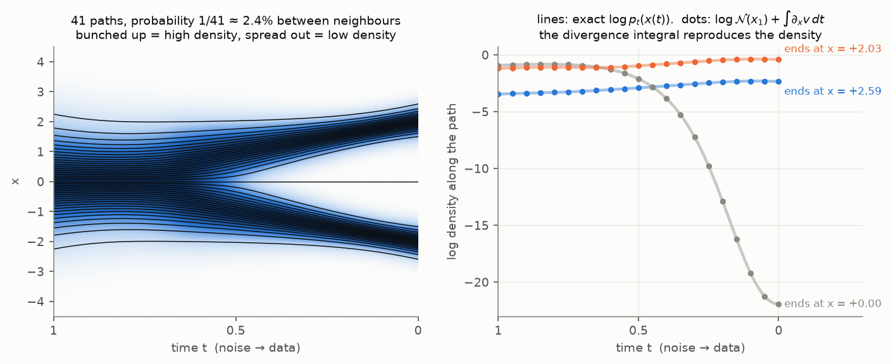

*Left: 41 paths, started at evenly spaced quantiles of the noise, so probability $1/41$ lies between
every pair of neighbours. At the data end they bunch up in the bumps (high density) and spread out
over the valley (low density). Right: along three of these paths, the exact log-density (lines) and
the divergence formula (dots) agree. The path that ends in the valley loses about 20 units of
log-density. The path ending in the outer tail ($x = 2.59$) stays lower than the one ending at the
centre of a bump.*

The same quantity in 2D, for the trained flow-matching model on the sine band (Part 3; the formula
works for any velocity field):

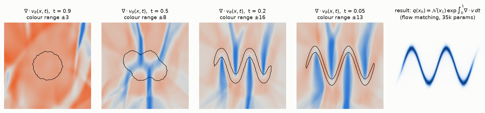

*Orange: $\nabla\!\cdot v > 0$. In generation (time running backwards), points there are pushed
together, so density grows. Blue: points are pulled apart, so density falls. Black line: where
$p_t$ is at 20% of its maximum, to show where the probability is. Early on ($t = 0.9$) nearly
everything is orange: the cloud first contracts a little. Later, blue ridges appear where the blob
is torn apart between the arches. Right: the density that results.*

In 2D the divergence is computed exactly, with one automatic-differentiation pass per dimension.
In high dimensions that is too slow, and it is estimated instead with Hutchinson's trick:
$\operatorname{trace}(A) = \mathbb E[r^\top A\,r]$ for a random vector $r$ with
$\mathbb E[r r^\top] = I$, which needs only one pass per random vector. That's why diffusion
likelihoods are expensive.

### Checkpoint, Part 2

| idea | formula |
|---|---|
| noising | $x_t = \alpha_t x_0 + \sigma_t\varepsilon$, with $\alpha_t^2 + \sigma_t^2 = 1$ |
| training | guess the noise: $\lVert\hat\varepsilon_\theta(x_t, t) - \varepsilon\rVert^2$, $t$ uniform |
| what it learns | the score: $\nabla\log p_t \approx -\hat\varepsilon_\theta/\sigma_t$ (least squares → average) |
| moving densities | continuity equation $\partial_t p = -\nabla\!\cdot(p\,v)$ |
| sampling | solve $dx/dt = -\tfrac12\beta(x + \nabla\log p_t)$ from $t = 1$ to 0 (Euler or RK4) |
| density | $\log q(x_0) = \log\mathcal N(x_1) + \int_0^1\nabla\!\cdot v\,dt$ |
| bumps come from | the score splitting gradually as the noise is removed |

---

## Part 3. Flow matching

Diffusion learns a score and *derives* a velocity from it. Flow matching asks: **why not learn the
velocity directly?**

### Step 3.1: Straight lines from noise to data

Pair a data point $x_0$ with a noise point $\varepsilon$ and connect them with a straight line:

$$
x_t = (1 - t)\,x_0 + t\,\varepsilon, \qquad \frac{dx_t}{dt} = \varepsilon - x_0 .
$$

This is the same form as diffusion, $x_t = \alpha_t x_0 + \sigma_t\varepsilon$, with the simplest
schedule possible: $\alpha_t = 1 - t$, $\sigma_t = t$ (bottom row of the figure in Step 2.2). At
$t = 1$, $x_1 = \varepsilon$ exactly. Train a network to predict the velocity of these lines, with
$t$ uniform in $[0, 1]$:

$$
\mathcal L_{\text{FM}}(\theta) = \mathbb E_{t,\,x_0,\,\varepsilon}\;
\big\lVert v_\theta(x_t, t) - (\varepsilon - x_0)\big\rVert^2 .
$$

This straight-line version is also called *rectified flow*. Note that $v$ points from data towards
noise, the direction of increasing $t$. Generation moves the other way, along $-v$.

### Step 3.2: Crossing lines, and their average

The lines **cross** (left panel below). At a crossing, one input has several different target
velocities. Just as in Step 2.4(a), least squares learns their **average**:

$$
v^*(x, t) = \mathbb E\big[\varepsilon - x_0 \;\big|\; x_t = x\big].
$$

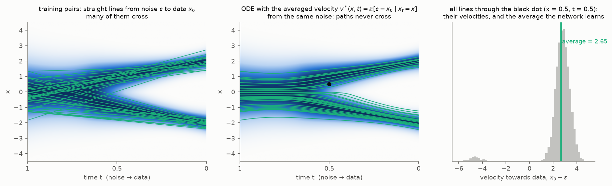

*Left: 40 training lines, from noise (left edge) to data (right edge). Middle: solving
$dx/dt = v^*(x, t)$ backwards from the same 40 noise points. The paths are curved, **never cross**,
and end in the two bumps. Right: all the lines passing through the black dot ($x = 0.5$, $t = 0.5$),
drawn in the generation direction $x_0 - \varepsilon$. Most go to the +2 bump ($x_0 - \varepsilon
\approx +3$), a few to the −2 bump ($\approx -4.5$); their average is +2.65. So the network learns
$v^*(0.5, 0.5) = -2.65$, and generation moves the point at speed 2.65 towards the +2 bump.*

### Step 3.3: Why following the average is exactly right

It may seem that following an *average* velocity would blur things. It doesn't. In 1D, in three
small steps:

1. Each training line is a single point moving with its own velocity $\varepsilon - x_0$. Together,
   all these points have density $p_t$ at time $t$.
2. The probability flowing past $x$ per unit time is the sum of the velocities of all points at $x$,
   which is (density at $x$) × (their average velocity) $= p_t(x)\,v^*(x, t)$.
3. Probability is conserved, so by Step 2.6, $\partial_t p_t = -\partial_x(p_t\,v^*)$. And by the
   converse in Step 2.6, moving points with $v^*$ reproduces exactly $p_t$.

Therefore solving $dx/dt = v^*$ from $\mathcal N(0, I)$ at $t = 1$ back to $t = 0$ lands **exactly**
on the data distribution, even though no training line was ever followed from start to end. The
density works exactly as in Step 2.9.

### Step 3.4: The same in 2D

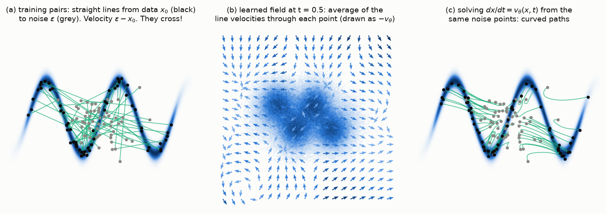

*(a) Training lines on the sine band, crossing everywhere. (b) The learned field halfway: at each
point, the average of all line velocities through it. Drawn as $-v_\theta$, the generation
direction, so the arrows point towards the data. (c) ODE paths from the same noise points: curved,
ending on the band. In the plane two paths can seem to cross, but at different times: an ODE never
puts two paths at the same place at the same moment.*

### Step 3.5: Flow matching and diffusion are the same family

Both use a path $x_t = \alpha_t x_0 + \sigma_t\varepsilon$. Its velocity is
$\dot\alpha_t x_0 + \dot\sigma_t\varepsilon$ (dots are time derivatives). Replace $x_0$ by
$(x_t - \sigma_t\varepsilon)/\alpha_t$:

$$
\dot\alpha_t x_0 + \dot\sigma_t\varepsilon = \frac{\dot\alpha_t}{\alpha_t}\,x_t + c_t\,\varepsilon,
\qquad c_t = \dot\sigma_t - \frac{\dot\alpha_t\,\sigma_t}{\alpha_t}.
$$

Averaging given $x_t = x$ turns $\varepsilon$ into $\hat\varepsilon$:

$$
v(x, t) = \frac{\dot\alpha_t}{\alpha_t}\,x + c_t\,\hat\varepsilon(x, t).
$$

So **a noise predictor is a velocity predictor**: the velocity is a fixed combination of $x$ and
$\hat\varepsilon$. (For the straight path $\alpha_1 = 0$, so this form only holds for $t < 1$;
the flow-matching network predicts $v$ directly and never divides by $\alpha_t$.)

**Check with the diffusion schedule.** There $\dot\alpha_t = -\tfrac12\beta\alpha_t$ and, from
$\sigma_t^2 = 1 - \alpha_t^2$, $\dot\sigma_t = \tfrac12\beta\alpha_t^2/\sigma_t$. So
$\dot\alpha_t/\alpha_t = -\tfrac12\beta$ and
$c_t = \tfrac12\beta\,\alpha_t^2/\sigma_t + \tfrac12\beta\,\sigma_t = \tfrac12\beta/\sigma_t$, giving

$$
v(x, t) = -\tfrac12\beta\,x + \tfrac12\beta\,\frac{\hat\varepsilon(x, t)}{\sigma_t},
$$

exactly the probability-flow ODE of Step 2.7. (Checked numerically on the two bumps: agreement to
$10^{-15}$.)

**The losses agree too, up to a weight.** Per training example, the velocity error is
$c_t\,(\hat\varepsilon - \varepsilon)$, so on the same path the velocity loss is the noise loss
multiplied by $c_t^2$. Choosing $\hat\varepsilon$ or $v$ only changes **how much each $t$ counts**.

So the only real differences are the **schedule** (which changes how curved the paths are) and
**the weight of each $t$ in the loss**:

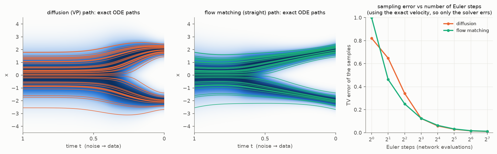

*Both use the exact velocity, from the same 40 noise points. Left: diffusion paths stay almost
still until about $t = 0.5$, then turn sharply. Middle: flow-matching paths move more evenly and are
straighter. Right: sampling error with Euler's method (Step 2.8), measured as the total-variation
(TV) distance between the histogram of the samples and the true density: half the summed absolute
difference, from 0 (perfect) to 1 (no overlap). In this tiny 1D example the two need about the same
number of steps (flow matching is a bit better at 2–4 steps). At 1 step flow matching is even
worst: at $t = 1$ the averaged velocity is $v^*(x, 1) = x - \mathbb E[x_0] = x$, so one Euler step
sends every point to the data mean, 0, between the bumps. The individual training lines are straight,
but their average is not (middle panel), so the "one Euler step" of Step 2.8 does not apply. With
learned fields in higher dimensions, straighter paths usually pay off more.*

In REPORT.md, Section 7.4, the two methods ended up practically tied, as this suggests.

### Checkpoint, Part 3

| idea | formula |
|---|---|
| path | straight lines $x_t = (1 - t)x_0 + t\varepsilon$ |
| training | $\lVert v_\theta(x_t, t) - (\varepsilon - x_0)\rVert^2$, $t$ uniform |
| what it learns | the average velocity $\mathbb E[\varepsilon - x_0\mid x_t]$, which transports $p_t$ exactly |
| sampling and density | as for diffusion: an ODE, plus the divergence integral |
| relation to diffusion | same family; $v = \frac{\dot\alpha}{\alpha}x + c_t\hat\varepsilon$, and the losses differ only in the weight per $t$ |

---

## Part 4. All three side by side

The same 400 noise points traced through the three trained models on the 4×4 grid target (Part 0):

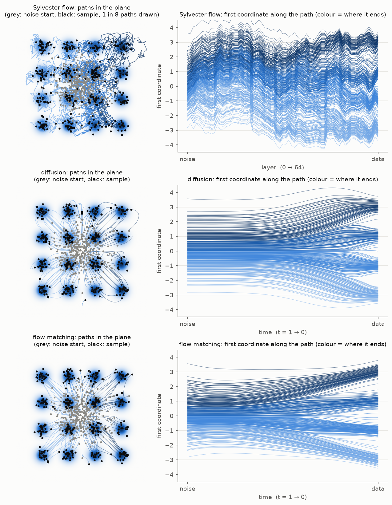

*Left column: the paths in the plane. Right column: the first coordinate along each path, coloured
by where the path ends. Because the colour is set by the end point, the colours look sorted from
the start; what matters is when the paths separate into the four horizontal levels.*

- **Sylvester flow (top):** 64 discrete jumps. Nothing forces the jumps to be small or go straight
  for the target; points are shoved back and forth, and the four columns only form near the last
  layers. That is the freedom (and the burden) of designing the map layer by layer.
- **Diffusion and flow matching (middle, bottom):** smooth paths that split into the columns
  gradually, mostly in the second half. That is the coarse-to-fine splitting of Step 2.2.
- **Cost:** the flow's 64 jumps are the whole sampler: one pass, about 5k FLOPs per sample. The
  ODEs need many solver steps (Step 2.8), each a full network evaluation. In exchange, their
  network has no constraints at all.

**The three in one table**

| | normalizing flow (Sylvester) | diffusion (VP, probability-flow ODE) | flow matching (straight lines) |
|---|---|---|---|
| map from noise to data | $x = f_L\circ\dots\circ f_1(z)$ | $\dfrac{dx}{dt} = -\tfrac12\beta(x + \nabla\log p_t)$ | $\dfrac{dx}{dt} = v_\theta(x, t)$ |
| one step | $z + QR\tanh(\tilde RQ^\top z + b)$ | RK4 step through $-\tfrac12\beta x + \tfrac12\beta\,\hat\varepsilon_\theta/\sigma_t$ | RK4 step through $v_\theta$ |
| density | $\log p_Z(z) - \sum_l \log\lvert\det J_l\rvert$, with $z = f^{-1}(x)$ | $\log\mathcal N(x_1) + \int_0^1\nabla\!\cdot v\,dt$, with $x_1$ = end of the ODE path from $x$ | same as diffusion |
| volume change per step | $\sum_i\log(1 + h_i' R_{ii}\tilde R_{ii})$ (exact, $O(M)$) | $\nabla\!\cdot v$ (exact in 2D, estimated in high D) | same as diffusion |
| training loss | $-\log q_\theta(x)$ (needs the inverse) | $\lVert\hat\varepsilon_\theta(x_t, t) - \varepsilon\rVert^2$ | $\lVert v_\theta(x_t, t) - (\varepsilon - x_0)\rVert^2$ |
| what the loss really learns | the density itself | the score $\nabla\log p_t$ | the average velocity $\mathbb E[\varepsilon - x_0\mid x_t]$ |
| constraint on the network | invertible, triangular structure | none | none |

---

*Figures: `python math_figs.py all` (or a name such as `linear`, `compose`, `score1d`, …) →
`figures/m_*.png`. The 1D examples use exact formulas for the two-bump mixture. The 2D figures use
the trained models `results/e2_sine/sine2d2_L64_M2_relaxed_mle_s0.pt`,
`results/c_sine/sine2d2_{dm,fm}_h128x3_it45000_s0.pt`,
`results/e3_gallery/grid16_L64_M2_relaxed_mle_s0.pt` and
`results/c_gallery/grid16_{dm,fm}_h128x3_it60000_s0.pt` ("relaxed" is the parametrisation of
$R_{ii}\tilde R_{ii}$ from REPORT.md, Section 2; "h128x3" is a network with 3 hidden layers of 128
units).*
