# Can a normalizing flow turn one bump into many?

*Experiments with orthogonal Sylvester flows: from a single Gaussian to multimodal distributions.*

> **Status:** complete. 246 flow runs plus 207 comparison runs (diffusion, flow matching); all figures are in `figures/`.

---

## TL;DR

- **The question.** We start from the simplest distribution there is: one round Gaussian "bump".
  We want to know how complicated a distribution, with how many separate bumps (modes), an
  orthogonal Sylvester flow can turn it into.
- **The running example** is a sine wave. Pick an angle, compute its outcome sin(angle). Over a
  few periods, many different angles give the *same* outcome. So if you know only the outcome, the
  possible angles form many separate bumps. The more periods, the more bumps.
- **The plan.** Train flows of different sizes on toy distributions of increasing difficulty,
  then count how many bumps they get right.
- **The answer.** Yes, it works. With 64 layers the flow fits the sine band for up to **3
  periods** (6 angle bumps per outcome, all found), gets most of 4 periods, and fails at 6. It also
  makes a 4×4 grid of 16 blobs, a checkerboard and a spiral. Depth is what buys complexity, and
  maximum-likelihood training finds far more bumps than the usual reverse-KL training.
  Details in Section 5.
- **Versus diffusion and flow matching** (Section 7). At the *same size and training compute*,
  the Sylvester flow fits better than both on almost every target, and draws a sample in one
  pass instead of many. But diffusion and flow matching use an unconstrained network that
  scales freely: with a normal-size network (35k parameters, 15× compute) they fit 6 periods
  (25 of 26 bumps), which no flow here manages.

---

## 1. The idea in plain words

### What a normalizing flow does

Imagine a Gaussian blob of dough. A normalizing flow is a sequence of **smooth stretches and
bends** applied to that dough. You may stretch, squeeze and bend it, but you may **never tear or
glue** it. Because every step can be undone exactly, we always know how dense the dough is at
any point. That is what makes flows useful: you can both *sample* from them and *compute
probabilities* with them.

In symbols: draw $z$ from the base Gaussian $\mathcal N(0, I)$ and push it through an invertible
map $f = f_L \circ \dots \circ f_1$ to get $x = f(z)$. The density of $x$ follows from the
change-of-variables formula:

$$
\log q(x) \;=\; \log \mathcal N\big(f^{-1}(x);\,0, I\big) \;-\; \sum_{k=1}^{L} \log \big|\det J_{f_k}(z_{k-1})\big| .
$$

Here $z_{k-1}$ is the point just before layer $k$. The determinant term is the bookkeeping for
stretching: where a layer stretches space ($|\det J| > 1$), the density drops; where it squeezes,
the density rises.

### So how can one bump become many?

You can't tear the dough, but you can stretch a region so thin that almost nothing is left
there. Two thick lumps connected by a nearly empty thread look exactly like two separate bumps.
In the formula above, the gap between two bumps is a place where $|\det J|$ is huge, so $q(x)$
is tiny there.
So for a flow, "multimodal" means **one Gaussian with very thin, stretched necks between the
bumps**. The questions are:

1. How many necks or folds can a flow of a given size make?
2. Does training actually find them?

### Why the sine example is a little subtle

The *function* angle → sin(angle) cannot be a flow: many angles map to the same outcome, so you
cannot undo it. A flow can, however, learn the **cloud of (angle, outcome) pairs**: a thin wavy
band that follows the sine curve. Two views of that band:

- **Fix an outcome** (a horizontal line, e.g. outcome = 1) and look at which angles are likely.
  You see one bump every time the wave crosses that line: **2 bumps per period**. So 3 periods
  give 6 bumps, 6 periods give 12. (In the experiments we check two such lines, outcome = +1 and
  −1, so the reported totals are twice this. See Section 4.4.)
- **Look only at the outcome** and ignore the angle. You get two bumps near the top and bottom of
  the wave, because a sine spends most of its time near its peaks.

So we test both: the 2D (angle, outcome) band, and the 1D outcome distribution.

---

## 2. The model: an orthogonal Sylvester flow

Each layer of the flow does the following:

1. **Rotate** the space to pick a few directions to work in (the "orthogonal" part).
2. **Push points along those directions** by an amount that depends smoothly on where they are.
   It looks like a soft step (a tanh curve), so one side gets pushed one way and the other side
   the other way.
3. **Rotate back.**

As a formula, one layer is

$$
z' \;=\; z + Q\,R\,\tanh\!\big(\tilde R\, Q^\top z + b\big),
$$

where

- $Q \in \mathbb R^{D\times M}$ has orthonormal columns ($Q^\top Q = I$): the rotation in steps 1
  and 3. $Q^\top z$ gives the coordinates of $z$ along the $M$ chosen directions.
- $\tilde R$ (upper triangular, $M\times M$) and the bias $b$ decide *where* the soft step sits
  and how *sharp* it is.
- $R$ (upper triangular, $M\times M$) decides how *far* points get pushed.

Because $Q$ is orthogonal and $R, \tilde R$ are triangular, the determinant needed in Section 1
is cheap:

$$
\log\big|\det J\big| \;=\; \sum_{i=1}^{M} \log\Big(1 + \tanh'(\cdot)_i \; R_{ii}\,\tilde R_{ii}\Big).
$$

The layer is invertible as long as every term stays positive, which holds when
$R_{ii}\tilde R_{ii} > -1$ (since $0 < \tanh' \le 1$). How close the product gets to $-1$ sets
how strongly a layer can squeeze space together, which is exactly what carves a gap between
bumps.

One layer can create roughly one fold or one gap. Stacking many layers (**L** = number of layers)
gives many folds. A second size knob, **M**, is how many directions a layer works in at once. In
2D, M = 2 (both directions) is the full version; M = 1 is a cheaper version.

**Two flavours** (one ablation), which differ only in how the diagonals of $R$ and $\tilde R$ are
parametrised:

- `paper`: $R_{ii} = \tanh(a_i)$, $\tilde R_{ii} = \tanh(c_i)$, exactly as in the original paper
  (van den Berg et al., 2018). Both are bounded by 1, so each layer's push and sharpness stay
  small.
- `relaxed`: $\tilde R_{ii} = e^{c_i}$, $R_{ii} = \big(\mathrm{softplus}(a_i) - 1 + \varepsilon\big)/\tilde R_{ii}$.
  This is an equally valid but looser constraint: the product $R_{ii}\tilde R_{ii}$ can be any
  value above $-1$, so layers may be much sharper and push much further. My hypothesis is that
  sharp gaps are exactly what multiple bumps need.

## 3. How the flows are trained

Both ways of training minimise a **Kullback–Leibler (KL) divergence**, a measure of how
different two distributions are. Here $p$ is the target and $q$ is the flow:

$$
\mathrm{KL}(p\,\|\,q) \;=\; \mathbb E_{x\sim p}\Big[\log \tfrac{p(x)}{q(x)}\Big] \;\ge 0,
\qquad \text{with equality only if } q = p .
$$

KL is **not symmetric**: $\mathrm{KL}(p\|q) \neq \mathrm{KL}(q\|p)$. The two directions give two
training methods, and that asymmetry is what decides whether bumps get found or lost.

### 3.1 Forward KL = maximum likelihood (MLE)

$$
\mathrm{KL}(p\,\|\,q) \;=\; \underbrace{\mathbb E_{x\sim p}[\log p(x)]}_{\text{constant}} \;-\; \mathbb E_{x\sim p}[\log q(x)]
\quad\Longrightarrow\quad
\mathcal L_{\text{MLE}} = -\frac1N \sum_{n=1}^{N} \log q(x_n), \;\; x_n \sim p .
$$

- **What it needs:** *samples* from the target (here 200k example points), and $\log q(x)$ at
  those points. By Section 1, that means running the flow **backwards** ($f^{-1}$).
- **What it rewards:** the average is taken over target samples, and $\log q(x_n) \to -\infty$
  wherever the flow puts almost no mass. So **every bump of the target that the flow misses
  costs an enormous penalty.** Forward KL is *mass-covering*.
- **Typical failure:** when capacity is short, the flow would rather smear mass over the gaps
  than miss a bump, so the result looks **blurry**, with bridges between bumps.

### 3.2 Reverse KL

$$
\mathrm{KL}(q\,\|\,p) \;=\; \mathbb E_{x\sim q}\big[\log q(x) - \log p(x)\big] .
$$

- **What it needs:** only a *formula* for the target density, and it doesn't even have to be
  normalised. If $p = \tilde p / Z$, then $\log Z$ is just a constant and drops out of the
  gradient. No target samples are needed, and the flow only runs **forwards**:

  $$
  \mathcal L_{\text{rKL}} = \frac1N \sum_{n=1}^{N} \Big[\log q\big(f(z_n)\big) - \log \tilde p\big(f(z_n)\big)\Big],
  \qquad z_n \sim \mathcal N(0, I).
  $$

  Since $x = f(z)$ is a differentiable function of the parameters, gradients flow straight
  through the samples (the "reparameterisation trick"). This is how Sylvester flows are
  normally trained, e.g. inside a VAE.
- **What it rewards:** the average is now over the *flow's own* samples. Putting mass where
  $p \approx 0$ is punished hard ($-\log p \to \infty$), but **a bump the flow ignores costs
  almost nothing**, because the flow never samples there. Reverse KL is *mode-seeking*.
- **Typical failure: mode dropping.** The flow settles on a subset of the bumps and fits those
  well. Worse, once no samples land near a bump, the gradient carries no information about it,
  so it is unlikely to be found later.

### 3.3 A tiny example of the difference

Fit a single Gaussian $q$ to a target made of two well-separated bumps:

- **Forward KL** puts $q$ in the middle, wide enough to cover both bumps. That puts lots of mass
  in the empty gap, but no bump is missed.
- **Reverse KL** puts $q$ on top of *one* bump and ignores the other. Locally it is a perfect fit,
  but half the target is gone.

A flow has much more freedom than one Gaussian, but the same pressures remain. With limited
layers, MLE tends to show up as blur between bumps and reverse KL as missing bumps.

### 3.4 Tempering: a fix for reverse KL

To reduce mode dropping, I anneal the target. Early in training the flow fits a *flattened*
version of it:

$$
\mathcal L_\beta = \mathbb E_{x\sim q}\big[\log q(x) - \beta \log \tilde p(x)\big],
\qquad \beta: 0.05 \to 1 \text{ over the first 40\% of training.}
$$

At small $\beta$, $\tilde p^{\,\beta}$ is almost flat, so the flow first spreads over the whole
region where any bump lives. As $\beta$ grows, the bumps sharpen and the flow can carve them out
from that spread-out state, instead of having to discover them from a narrow one.

### 3.5 Summary

| | **MLE** (forward KL) | **Reverse KL** |
|---|---|---|
| what it uses | samples from the target | a formula for the (unnormalised) target density |
| direction the flow runs | backwards, $x \to z$ | forwards, $z \to x$ |
| punished hardest | missing a bump | mass where the target is empty |
| typical failure | blurry: bridges between bumps | **mode dropping**: some bumps ignored |

MLE usually isn't an option for Sylvester flows: it needs $f^{-1}$, and that is commonly said
not to exist in closed form. It turns out a layer can be undone exactly here (Appendix A), so I
ran both methods. That also lets us separate *"the flow can't represent this"* from *"the
training method can't find it"*.

## 4. The experiments

### 4.1 What one "run" is

Every number and every panel in the results comes from one **run**:

1. **Pick a target**: one of the distributions in the figure below.
2. **Pick the settings**: depth, flavour and training method (Section 4.2).
3. **Build a fresh flow.** Every layer starts close to the identity ($R_{ii}\tilde R_{ii} \approx 0$,
   biases $b \sim \mathcal U[-2, 2]$), so before training the flow outputs roughly the base
   Gaussian itself.
4. **Train it** for a fixed number of steps with the chosen method.
5. **Score it** against the true target on a fine grid (Section 4.5).

Runs never share anything, and there are 246 of them in total. A run is identified by its
settings, e.g. `sine2d3_L64_M2_relaxed_mle` is "3-period sine, 64 layers, M = 2, relaxed
flavour, maximum likelihood".

### 4.2 The four knobs

| knob | values tried | what it means |
|---|---|---|
| **L**: depth | 1, 2, 4, 8, 16, 32, 64 | number of stacked layers. Each layer can add roughly one bend or one gap, so this is the main capacity knob. |
| **M**: width of a layer | 1 or 2 (in 2D) | how many directions one layer pushes along at once. M = 2 uses the full 2D rotation; M = 1 pushes along a single direction (cheaper, fewer parameters). In 1D only M = 1 exists. |
| **flavour** | `relaxed`, `paper` | how the diagonals of $R, \tilde R$ are constrained (Section 2). `paper` = gentle layers, as in the original paper; `relaxed` = layers may be very sharp. |
| **training** | MLE, reverse KL | which KL is minimised (Section 3). MLE learns from target samples; reverse KL learns from the target's density formula. |

### 4.3 What stays the same in every run

| setting | value |
|---|---|
| base distribution | standard normal $\mathcal N(0, I)$, in 1 or 2 dimensions |
| optimiser | Adam with gradient-norm clipping at 10 |
| learning rate | one-cycle schedule: warm up to 3·10⁻³ over the first 5% of steps, then decay to ~0 |
| batch size | 512 points per step |
| training steps | 2,500 (E1), 3,000 (E2), 4,000 (E3) |
| MLE data | 200,000 exact samples from the target, drawn once; each step uses a random batch of 512 |
| reverse-KL samples | 512 fresh base samples per step; tempering $\beta: 0.05 \to 1$ over the first 40% of steps |
| random seed | 0 (one run per setting) |
| hardware | CPU, 12 runs in parallel |

### 4.4 The targets

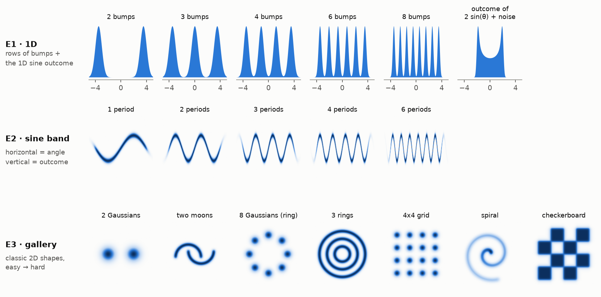

All targets live in the box $[-5, 5]$ (1D) or $[-5, 5]^2$ (2D), so every run solves a problem of
the same physical size.

#### E1: 1D, how many bumps per layer?

- **Rows of K bumps**, K ∈ {2, 3, 4, 6, 8}: K equal Gaussians with centres evenly spaced from
  −3.5 to 3.5 and width $\sigma = \min(0.5,\ \text{spacing}/6)$, so neighbouring bumps are always
  clearly separated (for K = 8: spacing 1, σ ≈ 0.17).
- **1D sine outcome**: $y = 2\sin\theta + \varepsilon$ with $\theta \sim \mathcal U[0, 2\pi)$ and
  $\varepsilon \sim \mathcal N(0, 0.15^2)$. This is the distribution of the outcome alone: two
  sharp peaks at ±2, because a sine lingers near its extremes.

**Grid:** 6 targets × L ∈ {1, 2, 4, 8, 16, 32} × {MLE, reverse KL} × {relaxed, paper} =
**144 runs**, all with M = 1.

#### E2: the sine band, how many periods? *(main experiment)*

The target is the joint distribution of (angle, outcome) pairs:

$$
x \sim \text{(soft) uniform on } [-4, 4], \qquad
y \mid x \sim \mathcal N\big(2\sin(\omega x),\ 0.2^2\big), \qquad
\omega = \frac{2\pi P}{8}.
$$

- $x$ is the angle, rescaled so that the interval $[-4, 4]$ always holds exactly **P periods**
  (P ∈ {1, 2, 3, 4, 6}). This keeps the target the same width for every P; only the number of
  wiggles changes. The edges of the uniform are slightly softened,
  $p(x) \propto \mathrm{sigmoid}(8(x+4))\,\mathrm{sigmoid}(8(4-x))$, so the density is smooth.
- $y$ is the outcome: amplitude 2, plus a little noise (σ = 0.2) to give the band some
  thickness.
- **Counting bumps.** A horizontal slice at a fixed outcome crosses the wave twice per period. We
  slice at two outcome levels, $y = +1$ and $y = -1$, so a P-period target has about $2P$ bumps
  per slice and $4P$ in total. At 4 and 6 periods, the soft edges add one partial bump per slice.
  The totals reported in the figures are therefore 4, 8, 12, 18 and 26.

**Grid:** 5 targets × L ∈ {8, 16, 32, 64} × {MLE, reverse KL}, relaxed flavour (40 runs), plus
the `paper` flavour at L ∈ {32, 64} (20 runs) = **60 runs**, all with M = 2.

#### E3: a gallery of classic 2D shapes, where does it break?

| shape | definition | what makes it hard |
|---|---|---|
| 2 Gaussians | centres $(\pm 2, 0)$, σ = 0.5 | one gap (warm-up) |
| two moons | two interleaved half-circles, band width σ = 0.15 | curved, interlocking pieces |
| 8 Gaussians (ring) | centres on a circle of radius 3, σ = 0.3 | 8 separate bumps, arranged in a loop |
| 3 rings | concentric circles of radius 1.2, 2.4, 3.6, width σ = 0.15 | nested: high–low–high along every radius |
| 4×4 grid | centres $\{-3, -1, 1, 3\}^2$, σ = 0.25 | 16 separate bumps |
| spiral | curve $r = 0.37\,t$, $t \in [0.6, 3.6\pi]$ (≈ 1.6 turns), width σ = 0.18 | one long, tightly wound curve |
| checkerboard | 8 filled squares of a 4×4 board on $[-4, 4]^2$, softened edges | 8 flat regions that touch only at corners |

The curve-shaped targets (moons, rings, spiral) are built as dense mixtures of small Gaussians
placed along the curve, which gives each of them an exact density formula for reverse KL.

**Grid:** 7 targets × L ∈ {16, 64} × {MLE, reverse KL} with M = 2 (28 runs), plus M = 1 at
L = 64 (14 runs) = **42 runs**, all with the relaxed flavour.

### 4.5 How results are scored

Each trained flow's **exact** density $q$ (computable thanks to the inverse, Appendix A) is
compared to the true, normalised target $p$ on a fine grid of points: 241 × 241 over
$[-5, 5]^2$, or 4,001 points in 1D.

- **TV distance** $\mathrm{TV}(p, q) = \tfrac12 \int |p(x) - q(x)|\,dx$, between 0 and 1: the
  fraction of probability mass in the wrong place. 0 is perfect, 1 means no overlap at all.
  Roughly: below 0.1 looks essentially right, around 0.3 has visible flaws, above 0.6 is a
  poor fit. Unlike the KLs it is symmetric, so it doesn't favour either training method. This
  is the main score.
- **Forward KL** $\mathrm{KL}(p\|q)$ on the same grid. It becomes large whenever a bump is
  missing, so it is a sensitive alarm for mode dropping.
- **Bumps found** (targets made of separate bumps: E1 rows, 2 Gaussians, ring, grid): a target
  bump counts as found if $q$ has its own local peak within one bump-width σ of the bump's
  centre. Shown as "found / total", e.g. 12/16.
- **Conditional bumps found** (E2 sine): along the slices $y = \pm 1$, count how many peaks of
  the true $p(\text{angle}\mid\text{outcome})$ also appear as a peak of $q$, within 0.35 in
  angle. Also shown as "found / total" (totals 4, 8, 12, 18, 26; see E2).

The bump counts are easy to read but can be fooled: a model that finds every peak may still put
extra mass in between. Always read them together with TV.

---

## 5. Results

All 246 runs finished. No run had a non-finite loss or a skipped step, and $Q$ stayed orthogonal
to $<10^{-6}$ in every model. Full numbers are in `results/summary.json`.

### 5.1 The main experiment: angle ↔ outcome of a sine (E2)

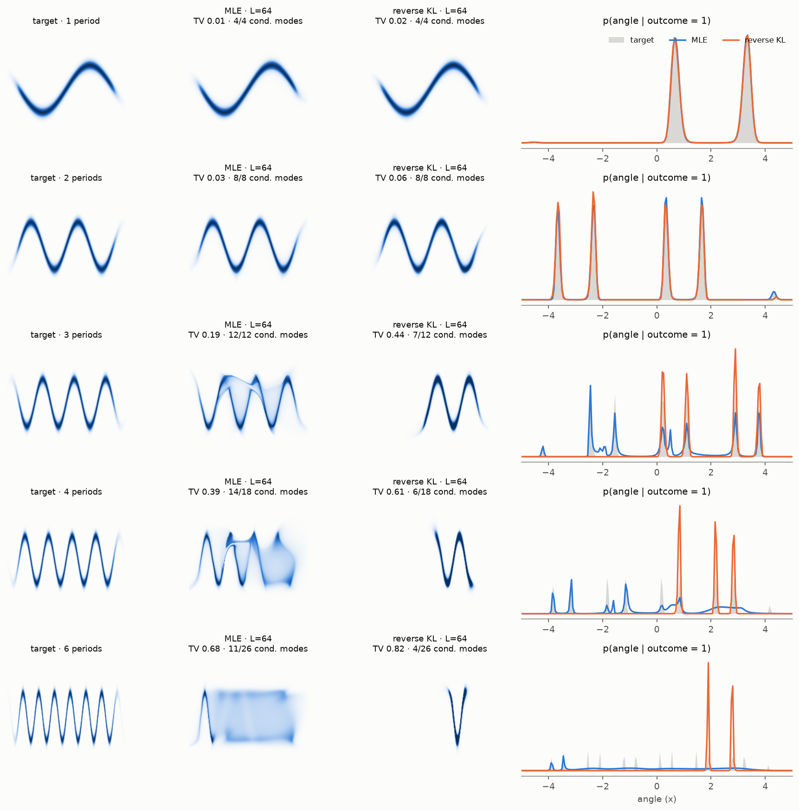

*Each row is one target. Column 1 is the target; columns 2–3 show the density of the flow trained
with MLE and with reverse KL, both with L = 64 layers, M = 2, relaxed flavour. Panel titles give
TV and conditional bumps found (both slices, $y = \pm1$, combined). The right column is the
horizontal slice at outcome = 1: grey is the true $p(\text{angle} \mid \text{outcome}=1)$, the
lines are what the two trained flows give.*

**Yes, one Gaussian can become many bumps.** Read the right column from top to bottom:

| periods | bumps in one slice (true) | MLE, L=64 | reverse KL, L=64 | verdict |
|---|---|---|---|---|
| 1 | 2 | ✅ perfect (TV 0.01) | ✅ perfect (TV 0.02) | easy |
| 2 | 4 | ✅ perfect (TV 0.03) | ✅ almost (TV 0.06) | easy with enough layers |
| 3 | 6 | ✅ all bumps found, but with a faint "sheet" of extra mass (TV 0.19) | ❌ drops one period (TV 0.44) | **the limit for this setup** |
| 4 | 8 (+1 partial at the edge) | ⚠️ most bumps, visible smearing (TV 0.39) | ❌ keeps ~1.5 periods (TV 0.61) | partly |
| 6 | 12 (+1 partial at the edge) | ❌ mostly a blurry rectangle (TV 0.68) | ❌ keeps one valley (TV 0.82) | fails |

So the **most complex output** that works reliably here is a sine band of **3 periods**: 6
separate angle bumps for every outcome level, all recovered.

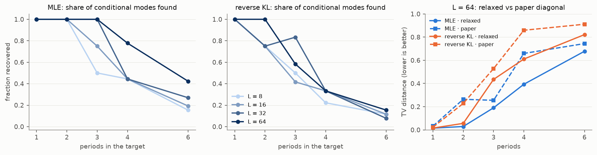

*Left and middle: the share of conditional bumps found, as the target gets more periods, for each
depth. Right: TV distance at L = 64 for both parametrisations.*

Three patterns:

1. **More layers buy more periods.** With MLE, each doubling of depth adds roughly one period
   before things break: L = 16 handles 2 periods (TV 0.10), L = 32 handles 3 (TV 0.20), and
   L = 64 gets most of 4. This matches the intuition that each layer adds about one bend.
2. **MLE and reverse KL fail exactly as predicted in Section 3.** MLE never loses a period: it
   covers everything and smears mass between periods instead. Reverse KL produces clean, sharp
   bands, but only for *some* of the periods; the rest are simply missing. You can see this in
   the forward KL, which is the alarm for missing bumps: for 3–6 periods, reverse KL scores
   $\mathrm{KL}(p\|q) \approx 10$–$40$ against $\le 1.5$ for MLE. Tempering helps (2 periods
   works) but doesn't fix it.
3. **The `paper` constraint costs capacity.** The dashed lines in the right panel lie above the
   solid ones from 2 periods on. With $|R_{ii}|, |\tilde R_{ii}| < 1$, each layer can only make
   gentle bends and shallow gaps, so even L = 64 gets just 4/18 bumps at 4 periods, against 14/18
   with the relaxed version.

#### How does the flow do it?

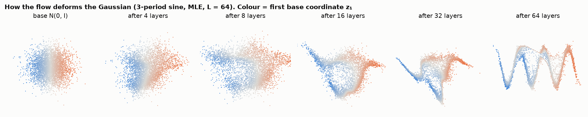

*Each dot is a sample from the base Gaussian, coloured by its first coordinate $z_1$ (blue = left,
orange = right). Panels show where the samples are after 4, 8, … 64 layers (3-period target, MLE).*

The colours stay in order from left to right all the way through. The flow does **not** fold the
Gaussian onto itself. It **stretches it into a long thin ribbon and bends that ribbon into a
wave**: the base coordinate $z_1$ becomes the angle, and $z_2$ becomes the thickness of the band.
The many bumps in $p(\text{angle}\mid\text{outcome})$ appear simply because a horizontal line
crosses the bent ribbon many times. This explains why difficulty grows with the number of
periods: the ribbon gets longer and needs more bends, and every bend costs layers.

### 5.2 The 1D outcome distribution and rows of bumps (E1)

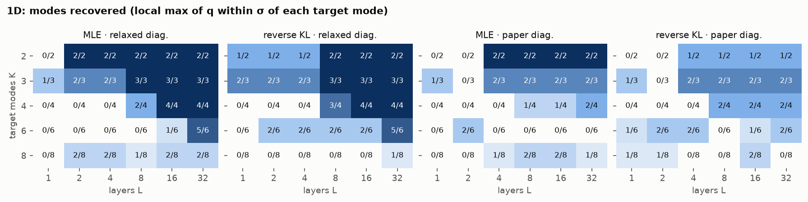

*Bumps found for every E1 run on the rows of bumps. One panel per combination of training method
and flavour; rows = number of target bumps K, columns = depth L. Darker = larger share found.*

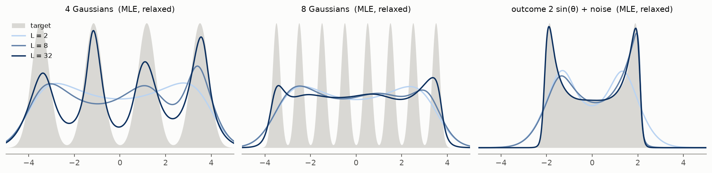

*Grey = target, lines = learned density for MLE with the relaxed flavour at L = 2, 8 and 32
(darker = deeper).*

- **The 1D outcome of a sine is easy.** The distribution of $2\sin\theta + \text{noise}$ (right
  plot, two sharp peaks at ±2) is fit almost perfectly from L = 16 on (TV 0.01–0.02), with
  either training method.
- **Rows of bumps in 1D are surprisingly hard.** With MLE and the relaxed parametrisation,
  4 bumps need L = 16, 6 bumps need L = 32 (5 of 6 found), and **8 bumps fail at every depth
  tried** (at most 2 of 8). The `paper` version never gets past 2 of 4.
- This is much worse than in 2D, where 16 bumps work (next section). My first explanation was
  flow-specific: in 1D a layer $z + r\tanh(\tilde r z + b)$ is one smooth monotone step, so a
  deep gap needs the slope $\prod_k (1 + r_k \tilde r_k \tanh'_k)$ to be nearly zero at exactly
  the right spot, whereas in 2D the flow can bend a ribbon instead.
- **Update after Section 7:** diffusion and flow matching with the same tiny parameter budget
  (~200 parameters) *also* fail on 6–8 bumps in 1D, and both succeed once given ~35k parameters.
  So the 1D difficulty is mostly a **capacity limit of ~200 parameters**, not something special to
  flows. A 1D flow with L = 32 simply has far fewer parameters (192) than the 2D flows (1,152 at
  L = 64).

### 5.3 The gallery (E3)

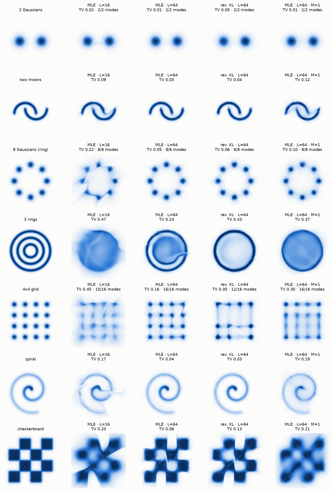

*Rows = targets. Columns = target, then four trained flows (all relaxed flavour): MLE with
L = 16 and L = 64 (M = 2), reverse KL with L = 64 (M = 2), and MLE with L = 64 but only M = 1.
Panel titles give TV, and bumps found where the target consists of separate bumps.*

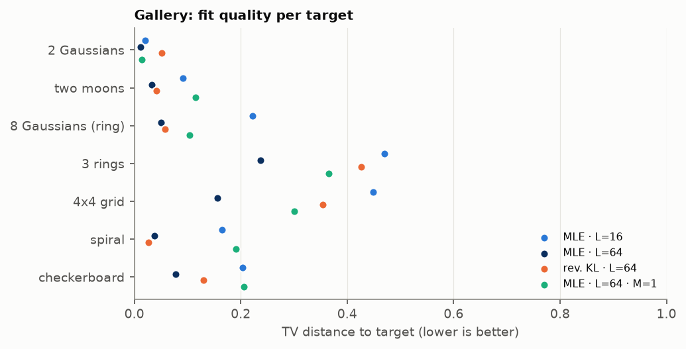

*The same four settings as TV scores, one dot per run; further left is better.*

With enough layers (L = 64), the flow handles most of the classic hard shapes:

- **Separated blobs are fine:** 2 blobs, 8 blobs on a ring (TV 0.05, all 8 found), and the
  **4×4 grid: all 16 bumps found** (TV 0.16).
- **Disconnected regions with sharp edges work too:** the checkerboard (8 separate squares)
  reaches TV 0.08. The squares are connected by very thin diagonal threads, which is the
  "can't tear the dough" constraint made visible.
- **Long curves work:** two moons (TV 0.03) and the spiral (TV 0.03–0.04) are essentially
  perfect.
- **Nested rings are the hardest shape here** (best TV 0.24). The flow manages the outer ring
  and part of the middle one, but fills the centre with a smear. Along every radius the target
  alternates high–low–high–low–high, so in the ribbon picture the Gaussian has to be wrapped
  around itself several times. The best model gets part of the way by spiralling (see the hook
  in the MLE L = 64 panel).
- **Depth matters most:** L = 16 → 64 roughly halves the TV on every hard target.
- **M = 2 beats M = 1** at the same depth (grid 0.16 vs 0.30, checkerboard 0.08 vs 0.21), but even
  the cheap rank-1 version finds all 16 grid bumps.
- Reverse KL is competitive on shapes that form one connected piece (spiral, moons, ring of
  blobs) and loses on the grid and rings, where it drops or merges bumps.

---

## 6. Conclusions

1. **Unimodal in → multimodal out works.** An orthogonal Sylvester flow turns one Gaussian into
   up to 16 separate blobs, a checkerboard, a spiral, or the (angle, outcome) band of a sine
   with **3 full periods: 6 angle bumps per outcome value**.
2. **The limit is set by depth.** The flow works by stretching the Gaussian into a ribbon and
   bending it, and every bend costs layers: 2 periods need about 16 layers, 3 periods about 32.
   At 4 periods (64 layers) it gets most of the way; at 6 it fails.
3. **How you train matters as much as the model.** Maximum likelihood (possible thanks to the
   exact inverse, Appendix A) finds every bump but may smear. Reverse KL, the usual way to train
   Sylvester flows, drops bumps for anything beyond ~2 periods.
4. **Use the relaxed diagonal.** The paper's tanh–tanh parametrisation is safe but limits how
   sharp each layer can be, which costs about one period of capacity.

**Caveats.** One seed per setting; fixed training budgets (2,500–4,000 steps). The
"bumps found" count is a heuristic that can look better than the picture (3 periods: 12/12
found, but with a visible sheet of extra mass), so read it together with TV. The laptop slept
for about 40 minutes mid-sweep; that inflated some recorded run times but did not affect any
result.

**Ideas for next steps.**
- **Conditional flow.** If the real goal is "given an outcome, sample possible angles", model
  $p(\text{angle}\mid\text{outcome})$ directly with a flow whose parameters depend on the outcome
  (an amortised Sylvester flow, as in the original VAE setting). It then only needs 1D
  multimodality per outcome, not a whole 2D ribbon.
- **Deeper and longer:** L = 128, more training steps and several seeds, to see whether 4–6
  periods become reachable or whether the trend is a real ceiling.
- **Compare with another flow family** (e.g. neural spline flows), which can make sharp 1D
  gaps per layer and might beat Sylvester flows on the 1D rows of bumps.

---

## 7. Comparison with diffusion and flow matching

Sections 1–6 asked what an orthogonal Sylvester flow can do. This section asks how it compares
to the two model families that dominate generative modelling today: **diffusion models** and
**flow matching**, at the same size and the same compute.

### 7.1 How the three families work

*A longer, illustrated version of this section is in [MATH.md](MATH.md).*

All three turn noise from $\mathcal N(0, I)$ into data. They differ in *how the map is built* and
*how it is trained*.

#### Normalizing flow (Sylvester): one fixed map, built from constrained layers

$x = f_L \circ \dots \circ f_1(z)$. Every layer must be invertible *and* have a cheap Jacobian
determinant, which is why the Sylvester layer has its special form (orthogonal $Q$, triangular
$R, \tilde R$). Training maximises the exact likelihood (Section 3). Drawing a sample is a single
pass through the $L$ layers.

#### Diffusion: learn to undo gradual noising

Start from a data point $x_0$ and add noise step by step until nothing but noise is left. With
the standard "variance-preserving" schedule:

$$
x_t = \alpha_t\, x_0 + \sigma_t\, \varepsilon, \qquad \varepsilon \sim \mathcal N(0, I),
\qquad \alpha_t^2 + \sigma_t^2 = 1,
$$

where $t$ runs from 0 (clean data) to 1 (pure noise). A neural network $\hat\varepsilon_\theta(x_t, t)$
is trained to **guess which noise was added**, by plain regression:

$$
\mathcal L_{\text{DM}} = \mathbb E_{x_0,\, \varepsilon,\, t}\,\big\|\hat\varepsilon_\theta(x_t, t) - \varepsilon\big\|^2 .
$$

That guess is equivalent to knowing the *score* $\nabla_x \log p_t(x) = -\hat\varepsilon/\sigma_t$:
the direction in which the noisy data gets denser. To generate, start from noise and repeatedly
step against the noising. Here I use the deterministic version, the **probability-flow ODE**:

$$
\frac{dx}{dt} = -\tfrac12 \beta(t)\Big(x + \nabla_x \log p_t(x)\Big),
$$

integrated backwards from $t = 1$ to $t \approx 0$ in many small steps. The ODE also gives an exact
density by the continuous change of variables, $\log q(x_0) = \log \mathcal N(x_1) + \int_0^1
\nabla\!\cdot v\, dt$. That's what lets me score these models with exactly the same grid metrics
as the flows.

#### Flow matching: learn the velocity along straight lines

Flow matching (here "rectified flow") skips the noise schedule. Draw a data point and a noise
point and connect them with a straight line:

$$
x_t = (1 - t)\, x_0 + t\, \varepsilon, \qquad \frac{d x_t}{dt} = \varepsilon - x_0 .
$$

A network $v_\theta(x, t)$ learns, again by regression, the average velocity of all such lines
passing through $x$ at time $t$:

$$
\mathcal L_{\text{FM}} = \mathbb E_{x_0,\, \varepsilon,\, t}\,\big\|v_\theta(x_t, t) - (\varepsilon - x_0)\big\|^2 .
$$

To generate, solve $dx/dt = v_\theta(x, t)$ from noise ($t = 1$) back to data ($t = 0$). Density
works exactly as for diffusion.

#### The key difference in one table

| | Sylvester flow | diffusion | flow matching |
|---|---|---|---|
| the map from noise to data | $L$ explicit layers | ODE through a learned field | ODE through a learned field |
| what the network must satisfy | invertible + cheap determinant (strong constraints) | nothing (any network) | nothing (any network) |
| training signal | exact likelihood (needs the inverse) | regression: predict the noise | regression: predict the velocity |
| cost of one sample | 1 pass | many network evaluations (steps of the ODE solver) | many network evaluations (often fewer: straighter paths) |
| exact density | 1 inverse pass | ODE solve + divergence | ODE solve + divergence |

In short, diffusion and flow matching are **also flows**, but continuous ones. Invertibility
comes for free because every tiny ODE step is close to the identity, so the network itself can be
completely unconstrained. The price is paid at sampling time: many network evaluations instead
of one.

### 7.2 Why expect a difference with multiple bumps?

- **Constrained versus free layers.** A Sylvester layer can only make one soft step along a few
  directions, so carving many gaps costs many layers (Section 5). An unconstrained MLP velocity
  field can, in principle, push different regions in completely different directions at once.
- **Built-in annealing.** At high noise ($t$ near 1) the noisy data distribution is a single blob,
  and it only splits into bumps as $t \to 0$. Diffusion and flow matching therefore learn the
  multimodality gradually, from coarse to fine. This is the same idea as the tempering trick in
  Section 3.4, but built into the method.
- **No mode dropping from the loss.** Both are trained by regression on samples from every bump,
  like MLE, so they shouldn't ignore bumps the way reverse KL does.

### 7.3 Making the comparison fair

| what | how it is matched |
|---|---|
| **network size** | The baseline network is an MLP $[x,\, t,\, \sin/\cos(2\pi k t)_{k=1..4}] \to$ SiLU layers $\to$ output. Its width is chosen to match the flow's trainable parameter count: **1,136 vs 1,152** (flow L = 64, 2D), **288 vs 288** (flow L = 16), **199 vs 192** (1D flow, L = 32). A standard-size MLP (3 × 128, ~35k parameters) is included as a *reference*, to show what these methods do when not held to the flow's size. |
| **data** | The same 200k-sample pool from the same target sampler, the same batch size of 512. The fair flow counterpart is therefore the **MLE**-trained flow; reverse KL uses the target's formula instead of samples, which the baselines cannot use. |
| **optimiser** | Identical: Adam, one-cycle learning rate with a peak of 3·10⁻³, gradient clipping at 10. |
| **scoring** | Identical: exact density on the same grid, TV and bumps found. For the baselines the density is that of the probability-flow ODE, solved with RK4 (50 steps). That's checked against a known Gaussian to 10⁻⁸ for flow matching; for diffusion, a 0.02 log-density offset comes from its σ = 0.01 noise floor. |
| **training compute** | The real issue. One MLE flow step is much more expensive than one regression step, so "same number of steps" would starve the baselines. I therefore count FLOPs (below) and give the baselines **1×, 5×, 15× and 50×** the flow's number of steps, which brackets "same training FLOPs". |
| **sampling compute** | Reported separately (Section 7.4.3): the flow needs one pass; the baselines need one network evaluation per solver step. |
| **seeds** | Three seeds for the flows (MLE and reverse KL) and for the baselines at the main budget on the sine; one seed elsewhere. |

#### Counting compute

Per sample, counting a multiply-add as 2 FLOPs and a tanh or log as about 10:

| operation | FLOPs per sample |
|---|---|
| one Sylvester layer, forward (D = M = 2) | ≈ 83 |
| **flow sample** (L = 64 forward) | ≈ 5.3k |
| one flow MLE step (inverse with 2 × 30 Newton iterations per layer, re-forward, backward), L = 64 | ≈ 211k |
| one MLP evaluation, 1.1k parameters | ≈ 2.6k |
| **baseline training step** (forward + backward ≈ 3 evaluations) | ≈ 7.8k |
| **baseline sample** | ≈ 2.6k × number of solver evaluations |

So at matched parameter count, one MLE flow training step costs roughly **27×** a baseline
step. The 15× and 50× budgets bracket that point. In the plots, training compute is shown as a
multiple of one flow MLE run.

Two caveats on the count. First, it depends on implementation: 30 Newton iterations is generous
(most points converge in under 10), so a tuned flow could be about 3× cheaper. Second, measured
wall-clock time is far more lopsided (about 500× per step) because my flow inversion is a Python
loop over layers and iterations. FLOPs are the fairer yardstick.

### 7.4 Results

All numbers are TV distance (0 = perfect, 1 = no overlap; lower is better) on the same grid as
in Section 5, with "bumps found" in brackets. Compute is given as a multiple of **one flow MLE run**
(L = 64, 3,000 steps ≈ 3.2·10¹¹ FLOPs). 207 extra runs in total.

#### 7.4.1 The sine band: quality versus training compute

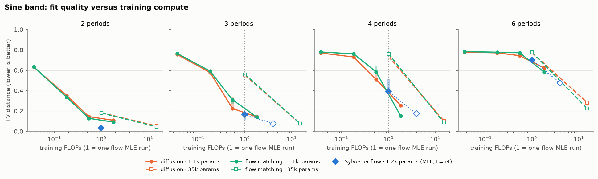

*Each line is one model size trained for longer and longer (3k → 15k → 45k → 150k steps for the
small baselines). Blue diamonds: the Sylvester flow at 3k steps (filled, 1×) and 12k steps (open,
4×). Shaded bars: spread over 3 seeds. The dotted vertical line marks "same compute as one flow run".*

| periods | **flow** 1.2k params, 1× | **flow**, 4× | diffusion 1.1k, 0.55× | flow matching 1.1k, 0.55× | diffusion 1.1k, 1.8× | flow matching 1.1k, 1.8× | diffusion 35k, 15× | flow matching 35k, 15× |
|---|---|---|---|---|---|---|---|---|
| 1 | **0.02** (4/4) | – | 0.07 (4/4) | 0.07 (4/4) | 0.04 | 0.03 | 0.03 | 0.02 |
| 2 | **0.03** (8/8) | – | 0.14 (8/8) | 0.13 (8/8) | 0.11 | 0.09 | 0.05 | 0.05 |
| 3 | 0.16 (12/12) | **0.08** (12/12) | 0.27 (12/12) | 0.29 (11/12) | 0.14 (12/12) | 0.14 (12/12) | 0.08 (12/12) | 0.08 (12/12) |
| 4 | 0.43 (13/18) | 0.17 (16/18) | 0.55 (13/18) | 0.60 (9/18) | 0.26 (16/18) | **0.15** (18/18) | 0.10 (18/18) | 0.09 (18/18) |
| 6 | 0.70 (10/26) | **0.47** (16/26) | 0.75 (9/26) | 0.77 (8/26) | 0.62 (17/26) | 0.58 (21/26) | 0.28 (24/26) | 0.22 (25/26) |

(Flow and 0.55× columns: mean of 3 seeds. Reverse-KL flows, which use 0.075× compute but no
samples, are shown in Section 5.)

What this says:

- **At the same size, the flow is the most compute-efficient.** For every number of periods, the
  blue diamonds sit at or below the orange and green curves at the same compute. For 1–2 periods,
  the small baselines need about 2× the flow's compute and are still 3–4× worse.
- **The flow also keeps improving with more training.** Training it 4× longer halves its error at
  3 and 4 periods (0.16 → 0.08, 0.43 → 0.17). An earlier version of this comparison, with the flow
  stuck at 1×, suggested the baselines overtake it at 4 periods; that was a flow-budget artefact.
  At 4 periods, small flow matching (0.15 at 1.8×) and the flow (0.17 at 4×) end up tied.
- **None of the ~1.2k-parameter models can do 6 periods.** All of them leave the band as a blurry
  box (picture below). So the ceiling of Section 5 is mostly a *size* ceiling, not something
  special to flows.
- **A normal-size network removes the ceiling.** With 35k parameters and 15× the compute,
  diffusion and flow matching fit 6 periods with 24–25 of 26 bumps. That's the real advantage of
  these methods: their network is *unconstrained*, so it scales by simply making it wider. A
  Sylvester flow with 35k parameters would need ~2,000 layers in 2D (each layer has only ~18
  parameters), and it would be far slower to train.
- **Diffusion versus flow matching:** practically tied. Flow matching is slightly better with more
  capacity (6 periods: 0.22 vs 0.28), diffusion slightly better with very little training.

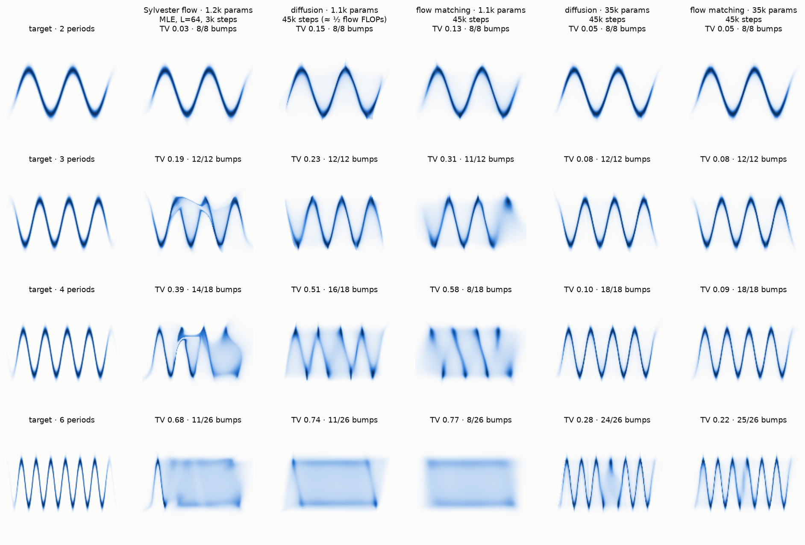

*Columns: target, Sylvester flow (1×), small diffusion and flow matching (0.55×), large diffusion
and flow matching (15×). Rows: 2, 3, 4, 6 periods.*

**They fail differently.** Look at the 3- and 4-period rows. The flow's mistakes are *sharp*: a
fold of the ribbon that cuts across the band, or a thin sheet of mass between two arches. That's
the stretch-and-bend mechanism of Section 5.1 failing to finish a bend. The baselines' mistakes are
*blurry*: every arch is roughly in the right place, but a haze of mass fills the space between them,
and at 4 periods the arches become slanted streaks. That's what an under-trained regression gives:
an averaged velocity field that doesn't quite separate neighbouring arches.

#### 7.4.2 The 2D gallery

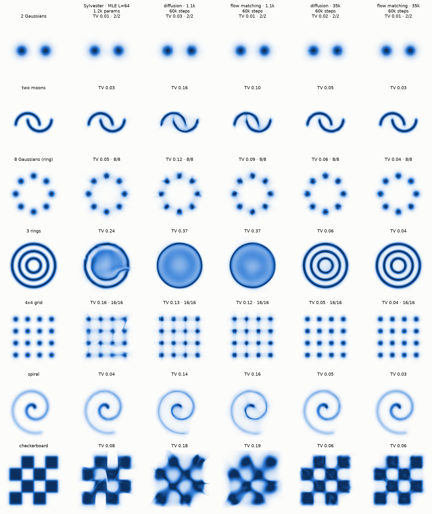

*Small baselines here get 60k steps ≈ 0.73× the flow's compute; the 35k-parameter references get
60k steps ≈ 20×.*

| target | **flow** 1.2k, 1× | diffusion 1.1k, 0.73× | flow matching 1.1k, 0.73× | diffusion 35k, 20× | flow matching 35k, 20× |
|---|---|---|---|---|---|
| 2 Gaussians | **0.01** | 0.03 | **0.01** | 0.02 | 0.01 |
| two moons | **0.03** | 0.16 | 0.10 | 0.05 | 0.03 |
| 8 Gaussians (ring) | **0.05** (8/8) | 0.12 (8/8) | 0.09 (8/8) | 0.06 | 0.04 |
| 3 rings | **0.24** | 0.37 | 0.37 | 0.06 | 0.04 |
| 4×4 grid | 0.16 (16/16) | 0.13 (16/16) | **0.12** (16/16) | 0.05 | 0.04 |
| spiral | **0.04** | 0.14 | 0.16 | 0.05 | 0.03 |
| checkerboard | **0.08** | 0.18 | 0.19 | 0.06 | 0.06 |

At the same size, the flow wins on six of seven shapes, often by 2–4×. On the moons, ring and
spiral it is as good as the 30× larger references. The one exception is the **4×4 grid**: it's the
most "many separate bumps" target, and the baselines' coarse-to-fine noising handles it a bit
better than the flow's ribbon folding (the flow leaves visible creases between the blobs). On
**3 rings** all small models fail. The baselines fill the rings into a solid disk; the flow gets
the outer ring right and part of the inner ones. Small baselines with ¼ of this budget (4k steps)
are much worse everywhere (TV 0.4–0.6, see `results/compare_tables.txt`).

#### 7.4.3 Sampling cost

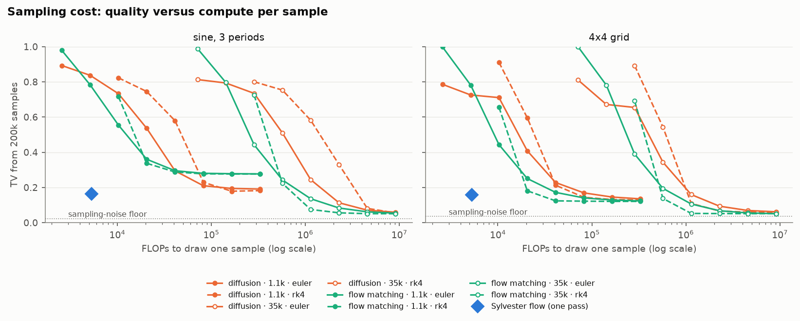

*Quality (TV from 200k samples, so even a perfect model scores about 0.02–0.04: the dotted
"sampling-noise floor") versus the FLOPs needed to draw one sample. Baselines: Euler and RK4
solvers with 1–128 steps.*

Here the flow is clearly better. One sample costs about **5.3k FLOPs**, roughly two evaluations
of the small MLP. At that cost the baselines produce mostly noise (TV 0.7–1.0). On the sine,
the small baselines **never** reach the flow's quality: their curves flatten at TV ≈ 0.2–0.3,
because more solver steps cannot repair a network that is too small. On the 4×4 grid, small flow
matching with RK4 matches the flow at about 8× its sampling cost. The large baselines beat the
flow on both, but only from around 10⁶ FLOPs per sample, i.e. **~100–200× the flow's sampling
cost**.

#### 7.4.4 The 1D rows of bumps

| target | **flow** L = 32, 192 params | diffusion 199, 0.07× | flow matching 199, 0.07× | diffusion 199, ~1× | flow matching 199, ~1× | diffusion 35k | flow matching 35k |
|---|---|---|---|---|---|---|---|
| 4 bumps | 0.16 (4/4) | 0.33 (2/4) | 0.39 (0/4) | **0.10** (4/4) | **0.10** (4/4) | 0.02 (4/4) | 0.02 (4/4) |
| 6 bumps | 0.32 (5/6) | 0.37 (0/6) | 0.40 (2/6) | **0.31** (2/6) | 0.32 (3/6) | 0.05 (6/6) | 0.03 (6/6) |
| 8 bumps | 0.36 (2/8) | 0.38 (0/8) | 0.40 (0/8) | **0.34** (2/8) | 0.36 (2/8) | 0.17 (7/8) | 0.07 (8/8) |
| sine outcome | **0.01** (2/2) | 0.13 | 0.12 | 0.03 | 0.02 | 0.01 | 0.01 |

In 1D the ~200-parameter versions of all three families stall at 4–6 bumps, while the large
baselines get all 8. This is why Section 5.2 now says the 1D limit is mostly about *size*.

#### 7.4.5 One weakness of the baselines: their density far from the data

To score the baselines I compute their density with the ODE. Far outside the data (corners of the
plot box) the learned velocity field is never trained. Some ODE trajectories started there blow up,
so the computed density is meaningless (stored as log q = −10⁴, i.e. zero). This doesn't affect
sampling, and it barely affects TV, but it makes their **forward KL infinite or unreliable**, which
is why this comparison uses TV and bump counts only. The Sylvester flow's density is exact and
finite everywhere, by construction.

### 7.5 Takeaways

1. **Same size: the Sylvester flow wins.** Per parameter and per training FLOP it fits the sine
   band and most 2D shapes better than diffusion or flow matching, and a sample costs one pass
   instead of tens to hundreds of network evaluations.
2. **Any size: diffusion and flow matching win.** Their network has no constraints, so a normal
   35k-parameter MLP fits 6 sine periods (25/26 bumps), 3 rings and a clean 4×4 grid, all of which
   are out of reach for the flows here. The constrained, invertible-with-a-cheap-determinant layer
   is exactly what makes the Sylvester flow efficient *and* what limits how far it scales.
3. **Fair comparisons need a compute model.** Counting steps would have made the flow look ~27×
   cheaper than it is; wall-clock time would have made it look ~20× more expensive. FLOPs put the
   two in the same units, and even then the conclusion at 4 periods flipped once the flow got a
   longer budget too.
4. **Choose by use case.** Need fast sampling, an exact and well-behaved density, or a very small
   model? A Sylvester flow is a good choice. Need the most complex distribution, and have compute
   for sampling? Flow matching (marginally ahead of diffusion here).

---

## Appendix A: technical details

### Layer details

The layer and its determinant are given in Section 2. Further implementation details:

- **$Q$** is made orthogonal with the paper's iterative procedure
  $Q \leftarrow Q\big(I + \tfrac12 (I - Q^\top Q)\big)$, starting from $W/\|W\|_F$ (25
  iterations). Every trained model is checked: $\|Q^\top Q - I\|_{\max} < 10^{-6}$.
- **No generality lost in `relaxed`:** forcing $\tilde R_{ii} > 0$ is harmless because tanh is
  odd. Flipping the sign of row $i$ of $\tilde R$, of $b_i$ and of column $i$ of $R$ leaves the
  layer unchanged.
- Each layer has its own free parameters (no encoder network, unlike in a VAE).

### Undoing the flow exactly

Write $v = Q^\top z$. Because $R$ and $\tilde R$ are upper triangular, coordinate $v_M$ only
depends on itself, $v_{M-1}$ on $(v_{M-1}, v_M)$, and so on. So a layer can be undone one
coordinate at a time, from the last to the first (back-substitution). Each step solves a
one-dimensional equation

$$
v + r \tanh(a v + c) = t, \qquad \frac{d}{dv}\big(v + r\tanh(av + c)\big) = 1 + r a \tanh'(\cdot) > 0,
$$

which is strictly increasing, with the root bracketed in $[t - |r|,\, t + |r|]$. Safeguarded
Newton solves it to machine precision (it falls back to bisection when a Newton step leaves the bracket or fails to halve the residual; see [MATH.md](MATH.md), Step 1.11, for a picture and a note on a solver fix that leaves all results unchanged). The part of $z$ orthogonal to the columns of $Q$ passes
through unchanged. This gives:

- **Exact densities** for every model, so the grid scores above are exact.
- **MLE training.** For correct gradients through the inversion, after finding the inverse
  $z^*$ without autograd I take one extra Newton step with $J$ held fixed:

  $$
  z \;\leftarrow\; z^* - J^{-1}\big(f(z^*) - x\big), \qquad
  J^{-1} = I - Q A (I + A)^{-1} Q^\top, \quad A = R\,\mathrm{diag}(\tanh')\,\tilde R .
  $$

  The value is unchanged (since $f(z^*) = x$), but its derivative equals the implicit-function
  derivative $\partial z / \partial \theta = -J^{-1}\,\partial f / \partial \theta$. $J^{-1}$
  costs only an $M\times M$ solve, via the Woodbury identity.

`test_flows.py` checks all of this: the inverse is accurate to 1e-8, the log-determinant matches
a brute-force Jacobian, and the gradients match finite differences.

### Training settings

All settings are listed in Section 4.3. Two extra notes:

- **Target samples for MLE** come from rejection sampling: uniform proposals in the box, accepted
  with probability $\tilde p(x) / \max \tilde p$ (the maximum estimated on the grid). These are
  essentially exact samples of the target restricted to the box.
- **Why CPU:** a tested GPU (Apple MPS) was about 5× slower per step, because each step is
  thousands of tiny operations on 2×2 matrices. GPU launch overhead dominates at this scale.

### Exact score definitions

- **TV:** computed on the grid, plus half of any flow mass that falls outside the box (that
  mass is in the wrong place by definition).
- **Bump found:** $q$ has a local maximum (in a 5-point neighbourhood, at least 5% of the
  highest value of $q$) within $\max(\sigma, 0.15)$ of the bump centre.
- **Sine conditional bumps:** true peaks are those of the slice $p(\cdot, y_0)$ with height
  $\ge 20\%$ and prominence $\ge 10\%$ of the slice's maximum. Flow peaks are those of $q(\cdot, y_0)$
  with height $\ge 10\%$ and prominence $\ge 5\%$. A true peak is matched if a flow peak lies
  within 0.35.

## Appendix B: files

| file | content |
|---|---|
| `flows.py` | the flow layer, exact inverse, log-probability with correct gradients |
| `targets.py` | all toy distributions |
| `train.py` | training, scoring, parallel sweep runner |
| `experiments.py` | the three experiment sweeps (`all`) and the comparison sweeps (`compare`) |
| `make_figures.py` | all figures |
| `baselines.py` | diffusion and flow-matching baselines, ODE sampler, exact ODE density |
| `compare_figs.py` | comparison figures, compute (FLOP) model and `results/compare_tables.txt` |
| `test_flows.py` | correctness tests |
| `MATH.md`, `math_figs.py` | illustrated explanation of the math of all three model families, and its figures |
| `results/<experiment>/*.pt` | trained weights and scores for every run |
